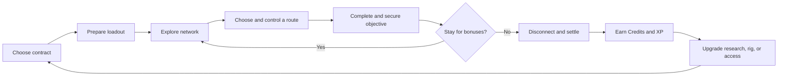
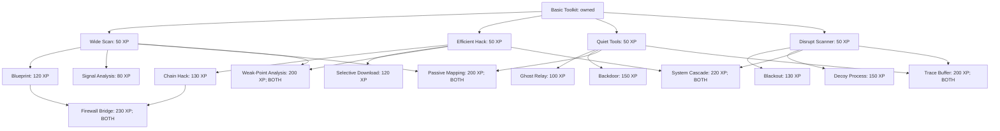
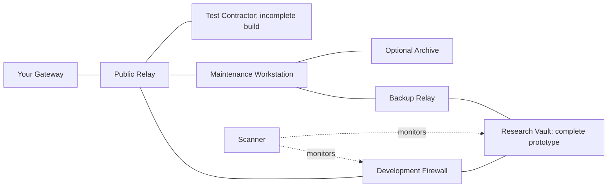
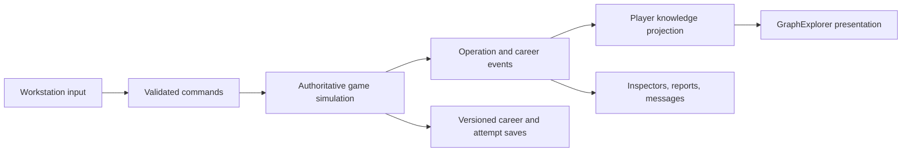

# Hack The Planet — Game Design Document

**Design direction:** Ghost Route  
**Version:** 1.0 — complete proposed design baseline  
**Date:** October 25, 2026  
**Primary platform:** Windows PC  
**Format:** Single-player, offline, real time with pause  
**Audience:** Players who enjoy approachable strategy, short network puzzles, upgrade trees, and a persistent career

> Build a freelance hacking career from your own virtual workstation. Discover clever paths through connected organizations, complete short contracts, spend earned XP in a graph-based tech tree, and turn useful footholds into a network you recognize as your own.

This document defines the intended game, including rules, content, progression, presentation, production scope, and acceptance criteria. Numbers are initial tuning values. Features described here are requirements or proposals, not claims that they are implemented. **Hack The Planet** remains the product name; **Ghost Route** names this design direction and does not require a rename.

## Contents

1. [Vision and design pillars](#1-vision-and-design-pillars)
2. [Product scope and player experience](#2-product-scope-and-player-experience)
3. [Core loops](#3-core-loops)
4. [Resources and career rules](#4-resources-and-career-rules)
5. [The persistent world graph](#5-the-persistent-world-graph)
6. [Operation graphs and information](#6-operation-graphs-and-information)
7. [Connection and access rules](#7-connection-and-access-rules)
8. [Actions and simulation time](#8-actions-and-simulation-time)
9. [Trace, security, and failure](#9-trace-security-and-failure)
10. [Mission math and balance model](#10-mission-math-and-balance-model)
11. [Contracts and rewards](#11-contracts-and-rewards)
12. [Research graph and XP](#12-research-graph-and-xp)
13. [Technology catalog](#13-technology-catalog)
14. [Hardware, loadouts, and supplies](#14-hardware-loadouts-and-supplies)
15. [Persistent infrastructure and contacts](#15-persistent-infrastructure-and-contacts)
16. [World changes and consequences](#16-world-changes-and-consequences)
17. [Story, factions, and campaign](#17-story-factions-and-campaign)
18. [Contract walkthrough: The Quiet Copy](#18-contract-walkthrough-the-quiet-copy)
19. [Procedural contract generation](#19-procedural-contract-generation)
20. [Workstation interface and controls](#20-workstation-interface-and-controls)
21. [Research interface](#21-research-interface)
22. [Visual and audio direction](#22-visual-and-audio-direction)
23. [Onboarding and accessibility](#23-onboarding-and-accessibility)
24. [Difficulty and replayability](#24-difficulty-and-replayability)
25. [Saving and technical design](#25-saving-and-technical-design)
26. [Content budget and production plan](#26-content-budget-and-production-plan)
27. [Validation and playtest criteria](#27-validation-and-playtest-criteria)
28. [Risks, tuning questions, and exclusions](#28-risks-tuning-questions-and-exclusions)
29. [Glossary and references](#29-glossary-and-references)

## 1. Vision and design pillars

### 1.1 High concept

Hack The Planet is a relaxed hacking career game played entirely through a fictional desktop. The player chooses a contract, explores a partly hidden network graph, controls useful machines, completes an objective, and disconnects. Contracts fund a better rig and award XP that is spent directly on technology nodes.

Across jobs, the player discovers that employers, targets, suppliers, and investigators belong to the same world. A university relay, a cooperative contact, or a shared maintenance identity can become a lasting advantage. The player builds a career and a small, understandable infrastructure.

The hook is **learning to see opportunities in a graph**. A firewall can be hacked, bypassed, or avoided. A scanner can be suppressed or permanently captured. A research purchase changes which arrangements look attractive. An old foothold can make a new contract feel personal.

### 1.2 Pillars

| Pillar | Design commitment | Practical test |
|---|---|---|
| Short, satisfying jobs | Most ordinary contracts take 5–10 minutes including thinking time. | A player can finish a useful session in 15 minutes. |
| Readable choices | Actions preview time, trace, prerequisites, and objective effects. | A player can explain why a route seems safer. |
| Depth through connections | Interesting topology, defense relationships, and research combinations create variety. | At least two approaches produce meaningfully different decisions. |
| A forgiving career | Failure costs an attempt and unbanked bonuses. Purchased progression persists. | A failed first attempt invites a retry. |
| An inhabited workstation | Contracts, research, infrastructure, messages, and consequences share one desktop. | Career growth is visible without leaving the workstation fiction. |
| Player-directed progression | Successful contracts award spendable XP; research refunds are free between jobs. | Players can try another build without grinding back a mistake. |

### 1.3 Decisions that define this version

- Three main resources: **Credits, XP, and Trace**.
- One active connection route. Authentication and extraction requirements appear as node conditions and action costs.
- Six enemy-network node types, plus the player's gateway.
- One foreground action at a time, with a small sequential queue.
- Unlimited pause and adjustable simulation speed in the standard game.
- No trace growth merely for reading or leaving the cursor still.
- A small research graph with four branches and meaningful crossovers.
- Persistent access has limited, clear benefits and requires no routine maintenance.
- Ordinary missions finish when settled. Surviving logs do not initiate a hidden campaign-wide investigation.
- No permanent equipment loss, debt spiral, or campaign-ending arrest in the standard game.

These decisions supersede the earlier three-route simulation, live CPU allocation, routine evidence cleanup, and continuous investigation proposal. Those ideas inform the setting and selected authored missions, but are not parallel systems the player must manage.

## 2. Product scope and player experience

### 2.1 Positioning

The game combines the freelance fantasy of a desktop hacking career with the readability of a compact strategy puzzle. It should feel clever, atmospheric, and inviting. It is not a programming exercise: commands, real exploit knowledge, reflex typing, and terminal memorization are never required.

Uplink is a reference for paid contracts, equipment progression, routed connections, and corporate intrigue. Its official description supports that inspiration. Hack The Planet's distinctive interaction is the visible relationship between routes, defenses, persistent access, and research choices. [Uplink official Steam page](https://store.steampowered.com/app/1510/Uplink_Hacker_Elite/)

### 2.2 Target experience

| Item | Target |
|---|---|
| Ordinary contract | 5–10 minutes of player time; approximately 2–4 minutes of active simulation |
| Introductory contract | 8–12 minutes including teaching and the first research purchase |
| Major story contract | 10–15 minutes; no forced long sessions |
| Minimum useful session | One contract, payout, and a progression decision in about 15 minutes |
| Critical story path | Approximately 90–150 minutes, excluding optional freelancing |
| A developed career | Approximately 4–6 hours including optional contracts, infrastructure, and build experimentation |
| Completionist progression | Approximately 20–30 successful contracts, depending on bonuses and chosen jobs |
| Business model | Premium offline game; no energy limits, paid XP, daily streaks, or real-time waiting |

These are playtest targets, not content guarantees. The story does not require buying the full tech graph or repeating contracts to meet a level gate.

### 2.3 Emotional arc

1. **Curiosity:** a cheap gateway and a few visible opportunities.
2. **Competence:** recognize nodes, compare routes, complete a first job.
3. **Ownership:** buy a useful technology and establish a first lasting foothold.
4. **Discovery:** notice the same organizations and identities in supposedly unrelated jobs.
5. **Agency:** choose which clients to help and which network advantages to use.
6. **Payoff:** resolve the central story, then keep freelancing in the changed world.

## 3. Core loops

### 3.1 Contract loop



At any point before the objective is secured, the player may abandon and retry. Once the main objective is secured, its base payout is protected even if the remaining session reaches maximum trace.

### 3.2 Moment-to-moment loop

**Select a node → read a short action preview → choose an action → observe progress and trace → inspect the result.**

The player repeatedly weighs three questions:

- Which path costs the least trace for the reward I want?
- Is it worth controlling or suppressing a defense before advancing?
- Should I disconnect with a guaranteed payout or risk an optional objective?

### 3.3 Long-term loop

Successful contracts unlock story opportunities, provide XP and credits, and reveal persistent world relationships. Purchases and footholds make future routes more flexible. New missions reuse recognizable organizations while changing objectives, defense patterns, and entry opportunities.

Research and the rig widen the player's choices. They should not reduce every network to clicking the shortest path.

## 4. Resources and career rules

### 4.1 The three resources

| Resource | Earned or changed by | Spent on or used for | Persistence |
|---|---|---|---|
| Credits, shown as `cr` | Successful contracts, secured bonus archives | Hardware and optional single-use supplies | Saved between jobs |
| Experience, shown as `XP` | Successful contracts and their declared bonus conditions | Purchasing research nodes directly | Unspent balance and purchases are saved |
| Trace, shown as `0–100` | Actions and active scanner coverage; selected tools can reduce it | Represents the current operation's pressure | Starts at zero each new attempt |

There is no separate research-point conversion. Spending 80 XP deducts exactly 80 XP. A player level is not required to buy a node whose prerequisites are satisfied.

### 4.2 Career standing

Reputation is represented by a **career title and completed milestones**, not a fourth spendable balance.

| Title | Milestone | What changes |
|---|---|---|
| New Handle | New career | Exchange access and first story contract |
| Reliable Freelancer | Complete The Quiet Copy | First infrastructure opportunity and ordinary job board |
| Known Quantity | Complete Ghost in the Wire | Investigation archive, contact leads, harder optional contracts |
| Independent Operator | Complete Glasshouse | Third infrastructure capacity and advanced board category |
| Ghost Route | Complete Last Light | Ending, epilogue world, and continuing freelance work |

Repeated easy contracts do not advance story milestones. Failing a job does not demote the player. Clients can respond to narrative choices through specific contracts and messages rather than an invisible global morality score.

### 4.3 Starting state

- 0 credits and 0 unspent XP.
- Basic Toolkit owned; all necessary baseline actions available.
- Starter processor, starter connection, and two special-ability slots.
- One infrastructure slot, initially empty.
- No paid supplies and no mandatory costs to accept work.
- The contract exchange, hardware shop, and first target visible on the world graph.

The tutorial's guaranteed base payout buys one 50 XP root technology and the first inexpensive hardware upgrade. Bonuses are helpful but unnecessary for that first progression moment.

## 5. The persistent world graph

### 5.1 World composition

The launch career uses three major organizations, an anonymous broker, a hardware shop, and a few supporting institutions. These are part of one persistent world, not unrelated mission maps.

| World entity | Role |
|---|---|
| Helix Dynamics | Robotics and energy research; prototypes, contractors, test systems |
| Morrow Financial | Debt and payment infrastructure; ledgers, mirrors, identity providers |
| Aegis Systems | Security and surveillance contractor; hubs, records, shared services |
| The Exchange | Anonymous contract broker; clear objectives and escrowed payment |
| Patchbay | Rig vendor; hardware and optional supplies |
| Calder University | Supporting institution; discoverable campus relay and public research ties |
| Community network cooperative | Contact and infrastructure opportunities associated with Null |
| Player infrastructure | Gateway, retained footholds, contacts, and saved investigation notes |

Organizations have stable identities and persistent machine IDs. An operation activates a relevant subnet of this world. Returning to Helix should preserve recognizable landmarks, previous discoveries, and explicit world changes.

### 5.2 Three scales, one workspace

| Scale | Shows | Typical decision |
|---|---|---|
| World | Organizations, clients, contacts, owned infrastructure | Which job or lead should I pursue? |
| Organization | Known subnets, entry points, important services | Which part of this company supports the objective? |
| Operation | Approximately 20–40 relevant machines | Which route and actions should I use? |

Expanding and collapsing clusters changes the presentation, not the simulation. The current target, active route, and objective remain easy to locate. Expanding an organization during a job never reveals unknown machines for free.

### 5.3 Relationship layers

The underlying world supports more relationships than the player needs to see at once.

| Relationship | Player-facing purpose | Default visibility |
|---|---|---|
| Network connection | Legal movement and adjacent hack opportunities | Always visible when known at operation scale |
| Authentication trust | An acquired credential satisfies a target condition or reduces its cost | When selecting a credential or affected target |
| Security coverage | Scanner exposure and hub protection | On relevant selection and action preview |
| Data flow | Backups, replicas, and investigation clues | During related contracts or when selecting a database |
| Ownership | Corporate links, suppliers, and narrative deductions | World and organization views |
| Player foothold | Saved entry opportunity or infrastructure benefit | World view and preparation |

Administrative control is a node state, not another always-visible edge layer. A mission does not require separately planning network, authentication, and extraction graphs. The extra relationships explain conditions and expose useful alternatives.

### 5.4 Truth and knowledge

The simulation stores authoritative world facts. The player graph stores discovered facts and their verification dates.

- Unknown nodes and connections stay hidden.
- A scan reveals information; it does not create a network connection.
- Known information includes a last-verified contract day.
- A major world change can mark related discoveries as **stale**.
- Stale entries use a hollow outline and a clear explanation, such as “Verified before Morrow rotated maintenance access.”
- Reverification occurs through a scan or the preparation preview for an equipped foothold.
- A mandatory connection cannot silently disappear midway through a normal job.

Core action costs become exact once the target is revealed. Unknown optional details can remain incomplete, but the interface must not display a confident cost that omits already-active defenses.

## 6. Operation graphs and information

### 6.1 Node types

The gateway is a player anchor. Enemy networks use six recurring node types.

| Type | Purpose | Normal interaction | Strategic value |
|---|---|---|---|
| Gateway | Player origin and automatic destination of secured data | Start, disconnect, inspect loadout | Stable home anchor; never a hostile objective |
| Workstation | Easy foothold, occasional signed record or bonus file | Hack; recover if it contains evidence | Cheap path and useful branching point |
| Relay | Connects network regions | Hack | Often an efficient route; candidate for a lasting foothold |
| Firewall | Hardened route barrier | Hack, detour, or use Firewall Bridge | Forces a meaningful path choice |
| Scanner | Adds trace while the active route touches its coverage | Hack to disable; optionally suppress | Can make a short route expensive |
| Database | Holds primary records, mirrors, or bonus archives | Hack, then Download or mission-specific action | Main reward and optional-risk destination |
| Security Hub | Raises security on explicitly linked defenses | Hack to disable; optionally suppress | A detour that makes several later actions cheaper |

Hacking a scanner or hub controls the machine and disables its defensive effect for the rest of that attempt. Suppression switches off only its defensive effect for a temporary duration; it does not grant machine control.

### 6.2 Node display

Every revealed node shows a distinctive shape or icon, short name, security pips, ownership marker, and relevant states. Selection adds a plain-language description and legal actions.

Mandatory states are **known**, **controlled**, **currently reachable**, **objective**, **bonus available**, **suppressed**, and **stale knowledge**. States use symbols and text as well as color.

Objective identity is never solely a tiny icon. The objective tracker can focus its known region or, when found, its specific machine.

### 6.3 Reveal rules

- Start with the gateway, briefed entry nodes, and any explicitly purchased or earned knowledge.
- A completed hack reveals immediate network neighbors and incident connection edges.
- A baseline Scan reveals machines and connections up to two network hops from a controlled, connected source.
- Scans reveal target identity, base security, relevant defense relationships, and any signed-record marker.
- Scans do not reveal a hidden region through an undiscovered ownership link or a purely visual cluster boundary.
- Scanning a node again is allowed, with no additional reward. It may reverify stale information.
- Information gathered during failed attempts is retained as knowledge, but control and mission payloads are reset.

The distinction between a scanned target and a target merely revealed by hacking is visible because Weak-Point Analysis uses that distinction.

### 6.4 Topology principles

Each ordinary operation should offer a direct path, an alternate path with a different defense tradeoff, and one optional reward detour. Branches reconnect often enough that exploration does not feel like choosing a wrong corridor.

Depth comes from arrangements such as:

- A hub protects a database and firewall, making a detour potentially worthwhile.
- A scanner covers a short entry path; a longer maintenance path avoids it.
- Two approachable nodes flank a firewall, enabling Firewall Bridge.
- A mirrored record requires two objectives, but shared infrastructure makes their routes overlap.
- A previously acquired identity offers an alternative entry without bypassing the whole mission.

Visual closeness is never a mechanical connection. Coverage and trust must have actual graph relationships and explicit indicators.

## 7. Connection and access rules

### 7.1 One active route

The current route is an ordered, simple path from the gateway to the focused action source or target. All intermediate hostile nodes must be controlled. The gateway is always controlled. A node outside the current route can remain controlled, but it does not carry the active session.

Selecting an already-controlled node offers **Route Here**, which chooses a legal path through controlled nodes. The player can pin route segments or select another legal path. The interface previews coverage and path overhead before switching.

Starting a hack extends a legal route by one known network edge to an uncontrolled target. On success, that target becomes controlled and the route endpoint. The player cannot act through an uncontrolled machine simply because it is visible.

The active action uses a fixed route. Selecting another node while an action runs changes the inspector, not that route. To reroute the action, cancel it and restart with the new preview. If an authored event breaks its route, the action stops and the game pauses with recovery options.

### 7.2 Connectivity and direction

Ordinary network links are bidirectional for accessibility. Explicit one-way transfers may appear as data-flow clues, but do not create traversable network edges.

Actions are allowed only if their source has a live path to the gateway, except for the explicitly described Backdoor ability. Previewing an unreachable target explains the missing condition and highlights a nearby legal step.

### 7.3 Credentials as conditions

Credentials are collectible tags with recognizable scopes, such as **Morrow maintenance**. They are not passwords the player types.

- A matching credential can satisfy a marked access condition or lower effective security by two, as specified on that target.
- Credentials do not create network reachability.
- Every mandatory ordinary objective has a baseline route without a research-exclusive credential.
- A credential-gated shortcut advertises an alternative route or the nearby place to obtain that credential.
- Credential use is automatic when beneficial, but the preview names the identity being used.
- Credentials acquired within an attempt expire with it unless established as a persistent access asset.

### 7.4 Extraction is part of recovery

Download includes packaging and transferring the requested material to the gateway over the current route. The player chooses a route and watches one action; there is no separate extraction-routing screen or manual packet management.

Long routes can increase transfer time. A reachable archive with a slow route may be less attractive than a smaller copy on another branch. These choices preserve the original routing fantasy without asking the player to maintain three simultaneous plans.

### 7.5 Avoiding the relay-chain solution

Adding a relay does not reduce trace automatically. More hops can increase action time and expose the route to more scanner coverage. A relay is useful because of its position, credential, or foothold benefit.

Route recommendations may offer **fewest hops** and **lowest estimated trace** over known, legal paths. They show their assumptions and never reveal unknown connections. The player chooses whether to accept a suggestion.

## 8. Actions and simulation time

### 8.1 Core actions

| Action | Requirement | Result | Typical baseline cost |
|---|---|---|---|
| Scan | Controlled, connected source | Reveal and mark targets within two network hops | 4 seconds; 2 action trace, plus exposed scanner pressure |
| Hack | Known target adjacent to a legal controlled source | Gain control; reveal immediate neighbors | Depends on effective security |
| Download | Controlled objective or archive | Recover payload; secure main objective when all requirements are satisfied | 8 seconds for a normal payload; 5 action trace |
| Alter Record | Controlled required record | Stage the requested edit; complete once all declared replicas are changed | 8 seconds; 5 action trace per required record |
| Recover Evidence | Controlled marked record node | Add a signed record to the current case | 6 seconds; 4 action trace per record |
| Disrupt Service | Controlled mission-designated service | Fulfill a disruption step | 8 seconds; 6 action trace |
| Route Here | Controlled node with legal path | Change active path and focus | Instant; no direct trace |
| Disconnect | Always available | End operation and settle eligible rewards | Instant; no action trace |

The toolbar uses the context-appropriate objective verb. Players learn Scan, Hack, Recover, and Disconnect first. Alteration and disruption appear only when a contract needs them.

Control research adds temporary defense-suppression actions. **Hack** remains a baseline way to disable a reachable scanner or hub, so buying Control is not required to solve the game.

### 8.2 Real time with pause

- Speeds: paused, 0.5×, 1×, and 2×.
- Time advances only in the active operation. Reading messages, shopping, and researching do not run the operation in the background.
- Pause freezes action progress, trace, suppression timers, and authored event countdowns.
- Players may inspect targets and prepare queue entries while paused.
- Starting or queuing an action while paused does not silently resume time. A visible Resume button executes the plan.
- Switching away from the operation pauses it automatically.
- New critical information and optional safety thresholds can auto-pause.

Standard mode has no real-world deadline. “Tomorrow's demonstration” means the next specified career event, not the player's actual next morning.

### 8.3 Action queue

Only one foreground action executes at a time. The baseline permits one upcoming action. Chain Hack increases capacity to three upcoming actions, including actions on a target expected to become reachable after the current hack.

Before each queued action starts, the game rechecks its legality and refreshes its cost. A changed route, suppression expiry, new defense, or unavailable target pauses the queue with an explanation. A materially increased trace cost requires the player's acknowledgement; it does not continue silently.

The queue never guesses a password, buys an item, uses a limited charge, or disconnects unless the player explicitly queued that instruction.

### 8.4 Cancellation and timing

Canceling an unfinished action keeps elapsed trace and loses its incomplete progress. Full effects and item consumption occur at successful completion unless an ability explicitly activates immediately. Instant abilities consume their use on activation.

Action trace accrues continuously over the action rather than appearing as a surprise at its end. Predicted totals include scanner pressure over its predicted duration. Timers and percentages do not round down internally.

Effective security and required work are sampled when an action begins. A hub returning from suppression does not retroactively lengthen a hack already in progress; it affects later actions. Scanner pressure is evaluated continuously, so a scanner returning during an action changes its remaining trace forecast. Known expiry times are included before starting.

Instant actions such as Decoy activation may be used during a foreground action. They do not create another foreground task. Timed special actions wait their turn in the same queue as hacking and recovery.

If main-objective completion and trace reaching 100 occur in the same simulation step, objective completion is resolved first. The protected base reward is then settled. This avoids an invisible fraction-of-a-second failure after a displayed completed action.

## 9. Trace, security, and failure

### 9.1 A single pressure meter

Trace is operation-wide and runs from 0 to 100. It measures how close local security is to closing the current session. It is not a second health bar for equipment, a persistent reputation penalty, or a hidden criminal case.

| Trace band | Presentation | Mechanical effect |
|---|---|---|
| 0–49 | Calm | Normal operation |
| 50–69 | Alert | Clear visual and audio warning; no hidden cost increase |
| 70–89 | High pressure | One warning and default auto-pause on first entering the band |
| 90–99 | Lockdown imminent | Strong warning, prominent Disconnect button, default auto-pause |
| 100 | Session closed | Current action stops and the operation settles |

The player can disable auto-pause warnings. Returning below a band does not trigger the same warning repeatedly unless a new attempt begins.

### 9.2 Scanner coverage

An active scanner adds **0.25 trace per simulated second of an executing foreground action** if any node on the active route is connected to it by a coverage relationship. Its own node counts as covered while it is being hacked. One scanner contributes once, even if it covers several route nodes.

At most two scanners may stack on a mandatory ordinary route, producing at most 0.5 trace per second. Optional challenge contracts can advertise denser coverage.

Unrevealed scanners affecting a revealed route appear as an **unidentified monitoring source** warning. Their current pressure is included in the action forecast; a scan reveals the machine and its coverage. A player is never promised “+4 trace” and then charged +12 by an undisclosed rule.

Idle time generates no scanner trace. Suppression timers still count down during unpaused idle simulation, so pausing is the reliable way to stop time. Waiting does not reduce trace, restore ability charges, or reset a cooldown.

### 9.3 Hub protection

An active hub adds two effective security to each explicitly protected firewall or database. The ordinary game allows one hub bonus per target; multiple hubs do not stack.

Capturing or suppressing a hub removes its bonus while the effect lasts. This is shown through defense links, changed security pips, and refreshed action previews.

### 9.4 Defender behavior

The first playable uses one deterministic defender response: the network closes the session at maximum trace. Scanners and hubs are static readable defenses.

Later authored contracts may add a **relay isolation event**. It names the affected node and gives at least 20 simulated seconds of warning. Its timer advances while actions are executing, pauses during idle inspection, and can be stopped with pause. The threatened route must have an available response: finish and leave, reroute, or use an equipped recovery ability.

Isolation affects only the active attempt. It does not delete a purchased or established asset. There are no invisible investigators walking the graph after an ordinary job.

### 9.5 Settlement rules

| Situation | Base credits and XP | Optional archives | Quiet and special bonuses | Career effect |
|---|---|---|---|---|
| Disconnect before main objective secured | None | Lost | None | Knowledge retained; attempt can be retried |
| Trace closes session before objective secured | None | Lost | None | Same as above |
| Voluntary disconnect after objective secured | Paid once | Paid if recovered | Paid if conditions satisfied | Contract success and declared world changes |
| Trace closes session after objective secured | Paid once | Unbanked archives lost | No quiet or special payout | Main contract still succeeds |
| Quit application during an active attempt | No settlement yet | Saved with attempt | Evaluated on later settlement | Resume in a paused operation |

Completing the main objective displays **Main objective secured — base payment guaranteed**. The player may immediately disconnect. Staying for bonus archives is optional risk after a real success.

Bonus archives are banked only when the player voluntarily disconnects after main success. They never award XP or credits independently of a successful contract. A disconnect before main success discards them, preventing side-loot farming on repeated failed attempts.

### 9.6 Retries

- Retry is free and resets trace, temporary control, payloads, action progress, and ability uses.
- Scanned knowledge remains in the journal; the graph can show remembered information.
- The same accepted contract keeps its seed and world revision until it is settled or abandoned.
- A failed attempt does not consume paid supplies from the career inventory; they return during failed settlement.
- A successful settlement consumes only supplies actually used in that attempt.
- Required story jobs remain available until completed.
- The board always includes an approachable ordinary contract with no entry fee.

## 10. Mission math and balance model

### 10.1 Security and baseline costs

Let `S` be effective security after the target's base rating, one applicable hub bonus, matching credential reduction, and technology effects. Clamp `S` to 1–8.

```text
S = clamp(base security + hub bonus - credential reduction - other reductions, 1, 8)

Hack duration before route and speed modifiers = 4 + 2S seconds
Hack action trace before reductions = 2 + 2S
```

| Effective security | Hack seconds | Action trace before scanner pressure |
|---|---:|---:|
| 1 | 6 | 4 |
| 2 | 8 | 6 |
| 3 | 10 | 8 |
| 4 | 12 | 10 |
| 5 | 14 | 12 |
| 6 | 16 | 14 |
| 7 | 18 | 16 |
| 8 | 20 | 18 |

### 10.2 Route overhead

Let `H` be the number of connections from the gateway to the action target, including the final connection for a hack.

```text
Hack/scan/service-action route multiplier = 1 + 0.03 × max(0, H - 3)
Recovery/transfer route multiplier       = 1 + 0.05 × max(0, H - 3)
```

Overhead is capped at 1.5× in ordinary contracts. It affects duration, not direct action trace, and can therefore increase scanner exposure. It is shown as part of the time preview rather than as a separate resource.

### 10.3 Modifier order

1. Determine target security and legal route.
2. Calculate base action duration and trace.
3. Apply relevant hardware speed divisors and duration multipliers.
4. Apply the route multiplier.
5. Apply action-trace reductions multiplicatively.
6. Add scanner pressure over the actual duration, accounting for suppression expiry.
7. Apply global trace reduction, such as Trace Buffer, to generated trace.
8. Apply explicit exceptions, such as Ghost Relay or Decoy's zero-generation window.

Hardware changes duration, not direct action trace. Quiet Tools and Weak-Point Analysis affect hack action trace, not scanner pressure. Signal Analysis removes Scan's direct trace, not environmental scanner pressure. An ability saying **zero trace, including coverage** overrides both sources for its described action only.

No negative duration or trace is possible. Display times to one decimal place and trace forecasts to one decimal place; retain precise internal values. Simultaneous percentage reductions multiply instead of adding to an accidental 100% discount.

### 10.4 Worked tradeoff

Ignore route overhead and upgrades in this local comparison:

- A direct security-4 firewall costs 12 seconds and 10 action trace. One scanner adds `12 × 0.25 = 3`, for **13 trace total**.
- Two unmonitored security-1 relays cost 12 seconds and 8 trace total.
- With Efficient Hack, the firewall takes 9 seconds and approximately 12.3 total trace.
- With Quiet Tools, the firewall costs 7 action trace plus 3 scanner trace, for 10 total.
- Suppressing the scanner removes its contribution while active, but consumes a Control action and time. It becomes attractive when several later steps also cross that scanner.

This is the intended depth: route layout, tool selection, and build strengths interact through a few understandable rules.

### 10.5 Difficulty budgets

| Board category | Machines | Typical main-path hacks | Primary objective budget with starter tools | Optional depth |
|---|---:|---:|---|---|
| Introductory | 12–20, expanding to 20–25 | 3–5 | At most 55 trace on a discoverable teaching route | One obvious bonus |
| Standard | 20–30 | 4–7 | At most 80 trace with no paid supplies or research | Two routes and up to two archives |
| Advanced | 25–40 | 5–8 | At most 85 trace on a valid baseline route | More defense interactions and optional conditions |

Every mandatory story objective has a starter-tool solution. Optional rewards can be difficult or impossible to collect all together with a particular build. The generator evaluates complete objective plans, including the scans a reasonable player needs, not just an omniscient shortest path.

## 11. Contracts and rewards

### 11.1 Contract card

Before acceptance, show client, target, objective, expected length, difficulty, base credits, base XP, known special conditions, and any announced world-changing consequence.

Every optional payout condition is visible before launch. A brief may hide a narrative motive, but cannot retroactively reveal that an ordinary success was secretly disqualified.

Only one contract is active at a time. Other offers remain visible and do not expire while the player is operating, shopping, or paused. Story-exclusive choices explain when selecting one resolves another.

### 11.2 Contract types

| Type | Main objective | Graph decision | Launch status |
|---|---|---|---|
| Copy | Control a marked source and recover the requested file | Secure source versus backup or contractor route | Core |
| Alter | Change the stated authoritative record and required mirrors | Find all required copies and a connecting route | Core |
| Investigate | Recover signed records and connect a simple evidence chain | Find which historical route fits the records | Core |
| Disrupt | Control a declared dependency and perform the service action | Disable a hub, then reach the dependent target | Core, introduced later |
| Rescue | Reach a stranded ally and create a temporary escape path | React to clearly telegraphed isolation | Optional authored mission after core validation |
| Surveillance | Establish a foothold and return for one follow-up job | Choose durable access and verify a later change | Optional authored mission; no real-time waiting |
| Plant evidence | Place a predesigned set of linked records | Match stated consistency rules across nodes | Deferred expansion, not launch-critical |

### 11.3 Investigation interaction

An evidence record contains a source, destination, timestamp, and a signed identity or transfer marker. The case panel lists recovered records and presents two or three plausible route chains. The player highlights the chain consistent with the available clues; the graph shows the matching connections.

Choosing incorrectly produces an explanation and allows another choice. There is no additional trace for thinking or revising the deduction. Recovering the necessary records is the intrusion challenge; reading them is a short, approachable reasoning step.

The main investigation objective is secured only after all required records are recovered and the consistent chain is selected. The case panel and brief show both requirements from the start.

The evidence schema is also used for the post-operation timeline. This creates a consistent world without simulating a persistent player prosecution system.

### 11.4 Reward model

| Successful contract component | XP | Credits | Conditions |
|---|---:|---:|---|
| Main objective | 50–140 authored; 55–65 ordinary freelance | Listed base payout | All required steps secured |
| Optional archive | +15 each, maximum +30 per contract | +100 each, maximum +200 | Recovered and banked on voluntary disconnect |
| Quiet completion | +10 | +150 | Voluntary disconnect; peak trace strictly below the listed limit |
| Special client condition | +15 | +150 | Only if explicitly listed; at most one per contract |

Standard freelance jobs do not all need a special condition. Bonuses never pay for speed by default. Quiet completion uses **peak trace during the attempt**, so reducing the meter immediately before disconnecting does not manufacture a stealth bonus.

Research refunds, remembered scans, repeated collection clicks, and replaying a completed story mission in practice mode do not produce XP. Fresh ordinary freelance contracts pay normally; choosing comfortable jobs is legitimate play.

### 11.5 Economy examples

- The Quiet Copy's base reward is 650 cr and 50 XP. This guarantees a 50 XP root purchase and the 500 cr first processor upgrade.
- With one optional archive and the quiet bonus, that first contract pays 900 cr and 75 XP.
- A typical freelance success pays approximately 700 cr and 60 XP before bonuses, or 1,050 cr and 100 XP with two archives and the quiet bonus.
- The six authored story contracts pay 7,250 cr and 525 XP in base rewards combined.
- All 17 purchasable research nodes cost 2,230 XP in total. The story alone intentionally does not buy the whole graph.

New technologies arrive every one to three successful jobs early on, and major crossover technologies take several jobs. Free refunds let a player change a build without earning the entire tree first.

### 11.6 Completion and payout integrity

Each accepted contract has a unique instance ID. Settlement records base rewards, each bonus, supplied-item consumption, world effects, and completion status in one transaction. A crash, reload, or repeated button press cannot award the same component twice.

Completing a story objective can apply a world consequence even when security subsequently closes the session: the player already accomplished the job. Abandoned or failed pre-objective attempts do not permanently edit campaign records.

## 12. Research graph and XP

### 12.1 Structure

The **Research Network** is a second graph inside the workstation. Basic Toolkit sits at the center, with Recon, Intrusion, Stealth, and Control extending outward. Crossover nodes connect neighboring branches.

The full baseline contains **18 nodes: one free root, twelve branch technologies, and five crossovers**. This is large enough to support builds while remaining understandable on one screen with modest panning.

| Branch | Core fantasy | Typical benefit |
|---|---|---|
| Recon | See options before committing | Reveal more topology, forecast objectives, exploit scanned weaknesses |
| Intrusion | Execute a plan efficiently | Faster hacks, longer queues, shorter main recovery |
| Stealth | Keep room for optional work | Lower trace, quiet relay entry, route recovery |
| Control | Change defenses before advancing | Suppress scanners and hubs, create a brief safe window |

### 12.2 Purchasing rules

- Earn XP from successful contracts; spend the same XP directly.
- Basic Toolkit is owned and costs zero.
- Ordinary nodes require their single parent to be owned.
- Nodes with two parents require **both** parents. The interface explicitly says “Requires both.”
- There are no character levels, random research drops, waiting timers, or credit costs for technology.
- Passive technology applies automatically.
- Special technology must be equipped in a loadout slot.
- Research purchases and refunds are available between operations only.
- Root branches are visible immediately. Deeper nodes show silhouettes and names; selecting a visible parent reveals full details one connection farther out.
- Once a node has been revealed, it stays visible, including after a refund. A full-tree preview is available for players who prefer to plan everything.

### 12.3 Free refunds

Refund one node or a whole branch for 100% of its paid XP. If a refund would invalidate descendants, preview the affected nodes and total refund, then require one confirmation for that concrete change. All invalid descendants are refunded together.

Refunded special abilities are unequipped. Loadouts remember valid remaining choices and highlight empty slots. A respec cannot occur in an active operation or reset ability charges.

No purchase can orphan another owned technology. A crossover's other branch is not refunded unless it also loses a prerequisite.

### 12.4 Research topology



The diagram specifies prerequisites, not an obligation to render research as a force layout. Research uses stable authored positions and labeled prerequisite lines.

## 13. Technology catalog

This table is the complete launch research specification. IDs align with the existing draft content where practical. Changes to cost, prerequisites, or behavior must also update the research display and preview calculations.

| ID | Technology | XP | Requires | Type | Exact proposed effect |
|---|---|---:|---|---|---|
| `base` | Basic Toolkit | 0 | None | Owned core | Scan two hops, Hack, context-specific objective actions, one queued action, Disconnect. |
| `wide` | Wide Scan | 50 | Basic Toolkit | Passive | Scan radius increases from two to three network hops. |
| `blueprint` | Blueprint | 120 | Wide Scan | Passive | At launch reveal every mandatory objective node and its immediate network neighbors. Does not grant reachability, control, credentials, or the scanned mark. |
| `signal` | Signal Analysis | 80 | Wide Scan | Passive | Scan duration is multiplied by 0.5 and Scan generates zero direct action trace. Scanner pressure still applies. |
| `efficient` | Efficient Hack | 50 | Basic Toolkit | Passive | Standard Hack duration is multiplied by 0.75. Direct action trace is unchanged. |
| `chain` | Chain Hack | 130 | Efficient Hack | Passive | Queue capacity increases from one to three upcoming actions. Enables explicitly selected multi-node sequential plans; no parallel actions or automatic resource spending. |
| `selective` | Selective Download | 120 | Efficient Hack | Passive | Download of required main-objective data takes 55% of normal duration and 70% of normal direct trace. Does not accelerate optional archives, Alter Record, or Recover Evidence. |
| `quiet` | Quiet Tools | 50 | Basic Toolkit | Passive | Standard Hack direct action trace is multiplied by 0.70. Scanner pressure is unchanged. |
| `ghost` | Ghost Relay | 100 | Quiet Tools | Passive | The first relay Hack started in each attempt generates zero trace, including scanner pressure during that hack. The protection is consumed when that hack starts, even if the player cancels it. |
| `backdoor` | Backdoor | 150 | Quiet Tools | Special | Once per attempt, mark a controlled workstation or relay while connected. If later isolated, reconnect to that same marked node once, instantly and without trace. Cannot seize an uncontrolled node, supply credentials, or target a database. |
| `disrupt` | Disrupt Scanner | 50 | Basic Toolkit | Special | From a connected controlled neighbor, spend 4 seconds and 2 direct trace to suppress a scanner for 60 simulated seconds. Two uses per attempt. Recasting does not stack duration or reset the use limit. |
| `blackout` | Blackout | 130 | Disrupt Scanner | Special | From a connected controlled neighbor, spend 6 seconds and 3 direct trace to suppress a hub for 60 simulated seconds. Two uses per attempt. Removes its protection, but does not grant control. |
| `decoy` | Decoy Process | 150 | Disrupt Scanner | Special | Once per attempt, activate instantly to remove 15 current trace, minimum zero, and prevent all trace generation for 20 simulated seconds. Does not reduce recorded peak trace or pause event timers. |
| `passive` | Passive Mapping | 200 | Wide Scan **and** Quiet Tools | Passive crossover | A completed relay Hack automatically reveals and marks scanned all nodes within the player's current Scan radius. No separate duration or direct trace. |
| `weakpoint` | Weak-Point Analysis | 200 | Wide Scan **and** Efficient Hack | Passive crossover | Hack direct trace against a target marked scanned is multiplied by 0.60. Stacks multiplicatively with Quiet Tools; does not reduce scanner pressure. |
| `cascade` | System Cascade | 220 | Efficient Hack **and** Disrupt Scanner | Passive crossover | The first time a hub is captured or suppressed, permanently reduce base security of its explicitly protected firewalls by two for this attempt. Applies once per firewall; does not affect unrelated firewalls or stack on repeated suppression. |
| `bridge` | Firewall Bridge | 230 | Blueprint **and** Chain Hack | Special crossover | Twice per attempt, spend 2 seconds to bridge one known firewall with two distinct, controlled, gateway-connected network neighbors. Grants traversal through that firewall without control. Generates zero trace, including coverage during the bridge action. |
| `buffer` | Trace Buffer | 200 | Quiet Tools **and** Disrupt Scanner | Passive crossover | All generated action and scanner trace is multiplied by 0.85. Does not change the trace cap or peak-history rule. |

### 13.1 Ability edge cases

- **Ghost Relay:** show an available-use badge before the first relay hack, and consume it on action start. A canceled or interrupted protected hack has generated zero trace so far, but the next hack is unprotected. The effect never refunds earlier trace or lowers peak trace.
- **Backdoor:** the original gateway and a synthetic private tunnel form the recovered route to the marked node. The tunnel is visible, valid until disconnect, and contributes two effective hops for route overhead. It is not an unlimited reusable teleport or a new persistent asset. Marking is instant, requires a special slot, and consumes no use until recovery.
- **Firewall Bridge:** bridged traversal applies to that firewall for the rest of the attempt. The two prerequisite neighbors must each be connected without using the firewall being bridged. The firewall's protected services remain protected by their own conditions. Bridging never gives access through a second uncontrolled neighbor.
- **System Cascade:** permanent weakening remains after the hub's temporary suppression ends, but the restored hub bonus still applies. Capturing a hub both removes its bonus and triggers its one-time cascade reduction.
- **Suppression:** its timer begins on completion. The target's defenses remain active during the suppression action itself, and the preview includes that exposure.
- **Decoy:** the zero-generation window includes action trace and scanner pressure. It does not create additional uses, grant objectives, or turn a forced closure into a voluntary disconnect.
- All use limits reset on a fresh attempt, not on pause, save/load, rerouting, or reopening a panel.

### 13.2 Example builds

| Build | Early purchases | Later goal | Interesting choice |
|---|---|---|---|
| Careful Mapper | Wide Scan, Signal Analysis | Passive Mapping and Weak-Point Analysis | Spend a little time learning the network to reduce later trace. |
| Fast Freelancer | Efficient Hack, Selective Download | Chain Hack and Firewall Bridge | Reach and secure the main payout quickly, then decide whether to stay. |
| Quiet Collector | Quiet Tools, Ghost Relay | Trace Buffer and Passive Mapping | Use safe entry paths to leave budget for optional archives. |
| Network Controller | Disrupt Scanner, Blackout | System Cascade with a Decoy loadout | Change a protected region before crossing it. |

These are suggestions rather than classes. The player may own every passive eventually and can freely combine branches. Limited special slots preserve a meaningful preparation choice.

## 14. Hardware, loadouts, and supplies

### 14.1 Hardware purpose

Credits buy operating capacity and speed. XP buys research capabilities. The rig does not require live task allocation, thermal management, recurring bills, inventory repair, or manual storage cleanup.

CPU and bandwidth are represented by two upgrade tracks. Memory is represented by special-ability capacity. Storage is generous enough for all required mission material and the permanent evidence journal; it is not a fourth management system.

| Track | Starting state | Upgrade purchase cost | Result |
|---|---|---:|---|
| Processor I | 1.0× processor speed | 500 cr | 1.15× speed for Hack, Scan, Alter Record, Recover Evidence, Disrupt Service, and timed special setup |
| Processor II | Requires Processor I | 1,400 cr | Replace processor multiplier with 1.30× |
| Processor III | Requires Processor II | 2,800 cr | Replace processor multiplier with 1.50× |
| Connection I | 1.0× transfer speed | 600 cr | 1.20× Download speed |
| Connection II | Requires Connection I | 1,600 cr | Replace connection multiplier with 1.45× |
| Connection III | Requires Connection II | 3,000 cr | Replace connection multiplier with 1.75× |
| Expanded Memory | Two special slots | 1,800 cr | Three special slots; maximum for launch |

Processor speed does not also speed up Download; the connection track handles it. A 1.50× speed multiplier divides duration by 1.50. Buying a higher tier replaces the prior tier's multiplier instead of multiplying all tiers together. Tech duration modifiers then multiply the adjusted duration.

Hardware never increases the trace cap. Better speed saves exposure under scanners, but cannot eliminate a firewall's direct action trace.

All hardware purchases are permanent and visible on the gateway. There is no mandatory resale system or gear rarity. Purchased hardware cannot be lost to mission failure.

### 14.2 Loadouts

Before launching, choose up to two special technologies, increasing to three with Expanded Memory. Passives consume no slots. A loadout screen explains each selected ability's target requirements, duration, and uses.

The only special technologies in the baseline are Disrupt Scanner, Blackout, Decoy Process, Backdoor, and Firewall Bridge. The rest are automatically active when owned.

The game warns about an empty slot but permits launching. It never demands a particular special for a mandatory story mission. A simple recommended loadout can be accepted with one click.

### 14.3 Optional supplies

Supplies are a secondary credit sink after basic progression is established. Introduce them after the third story contract; omit them from the first playable.

| Supply | Cost | Effect | Limit |
|---|---:|---|---|
| Survey Packet | 100 cr | Reveal one selected objective region's immediate perimeter at launch; does not mark targets scanned | One per attempt |
| Transfer Burst | 150 cr | Double connection speed for one chosen Download; activation is explicit | One per attempt |

Carry at most two supplies, one of each type. They occupy supply slots separate from research abilities. Unused items remain in inventory. Failed pre-objective attempts return used supplies; successful settlement consumes used supplies. Supply use is saved with the attempt, so reloads cannot duplicate stock.

Neither supply lowers trace directly or solves an objective automatically. Baseline validation never assumes supplies.

### 14.4 Comfort purchases

After functional needs are met, optional desktop themes, gateway shell appearances, and sound profiles can cost earned credits. They provide a long-term sink without increasing mission power. All readability and accessibility settings are free from the start.

## 15. Persistent infrastructure and contacts

### 15.1 Purpose

Infrastructure preserves the fantasy that the player has built something useful in the world. It should add route options and continuity without forcing a second maintenance game.

An infrastructure asset has a stable owner, associated graph nodes, a short benefit, supported target tags, last-verified day, and a clear operational state. Assets do not have upkeep fees or hidden discovery meters.

### 15.2 Establishing access

After the first story success, selected contracts may mark one optional **Establish Foothold** opportunity on a controlled relay or workstation. Its cost is 6 seconds and 4 direct trace, plus scanner exposure. The action appears in the same preview system as other mission actions.

Establishing access is provisional until a voluntary disconnect after main success. It awards an asset, not extra XP unless the brief explicitly lists it as the contract's special condition. A forced closure does not bank the new foothold.

Taking a foothold does not require deleting logs or revisiting it on a schedule. Assets do not expire while the player is offline.

### 15.3 Capacity and preparation

- The player starts with one asset capacity.
- Capacity increases to two after Paper Trail and three after Glasshouse.
- Capacity is a career feature, not a spendable currency or research prerequisite.
- A newly earned asset beyond capacity goes into the notebook as a discoverable replacement opportunity. The player chooses whether to replace an existing asset between jobs.
- Before a contract, equip one eligible asset as its infrastructure advantage. Other owned assets remain visible but provide no numerical stacking.
- The preview explains exactly where the equipped asset applies. An irrelevant asset never consumes a use or costs credits.

### 15.4 Asset catalog

| Asset | Acquisition | Benefit | Restriction |
|---|---|---|---|
| Calder campus relay | Early optional relay foothold | Start with one briefed perimeter relay controlled and revealed | Eligible public or academic-connected contracts only |
| Shared maintenance identity | Morrow-related foothold or follow-up job | Apply a two-security reduction to marked compatible targets | Network reachability still required; no stacking with another credential reduction |
| Contractor service account | Aegis optional access lead | Reveal and enable one alternate entry branch | Does not control the objective or remove its defenses |
| Infrastructure contact | Complete a short contact contract | Reveal a forthcoming change and one optional region at preparation | Information only; no trace reduction |
| Private evidence archive | Complete the first investigation and retain its records | Show known ownership and data-flow links in later related briefs | Narrative and planning benefit; no recurring management |

The archive is a permanent journal feature and does not occupy an equipped mechanical asset slot. Contacts with a concrete pre-operation advantage do occupy one when used.

### 15.5 Dormancy and sacrifice

A major authored world event may make an asset **dormant**. The message names the cause and offers a short reactivation contract or a replacement opportunity. It cannot invalidate an operation already accepted with that asset.

At most one asset is made dormant by a single story event. Ordinary contract failure never deletes an established asset. A dramatic story choice may let the player voluntarily burn one asset to secure an ally or a listed bonus; the exact sacrifice is shown before confirmation, and a baseline alternative remains available.

This gives the infrastructure emotional stakes while keeping the standard career recoverable and relaxed.

## 16. World changes and consequences

### 16.1 Event cadence

The career advances one **contract day** when a contract successfully settles. Failed attempts and time spent in menus do not advance the day. Changes are processed at settlement, then summarized in messages and the world graph.

There is no real-world clock, passive income schedule, daily login requirement, or background deterioration. The player controls when the next event happens by taking and completing work.

### 16.2 Consequence categories

| Consequence | Example | Player-facing result |
|---|---|---|
| Narrative | Helix's demonstration proceeds after research is leaked | News card, changed dialogue, later contract framing |
| Local security revision | Morrow replaces a shared maintenance identity | Marked information becomes stale; a later mission uses the revised access condition |
| Relationship discovery | Aegis funds a Morrow service through a shell company | New ownership edges and a story lead |
| Opportunity | A supplier starts backing up to a cooperative-hosted service | New route or infrastructure offer |
| Chosen asset sacrifice | Burn a foothold to protect a source | Named asset retired, alternative reward or ally outcome secured |

Ordinary contracts can produce minor visible revisions, but the game does not endlessly add security after every success. Each target has a bounded authored or procedural security budget. Easy work remains available even late in the career.

### 16.3 What persists

Persist ownership and known relationships, major machine identities, established assets, purchased progression, contract outcomes, collected story evidence, and news events.

Temporary mission control, trace, short-term suppression, bridge effects, and provisional loot reset after settlement. Reusing a known organization should feel familiar without allowing every past hacked workstation to remain permanently free.

### 16.4 Evidence boundaries

Evidence is used for investigation puzzles, story discoveries, and an explanatory operation history. It is not an ordinary post-mission cleanup requirement.

A special contract can explicitly ask the player to retrieve a surviving collector record or remove a declared audit copy. Its brief identifies the task and reward. It cannot arrive as an unavoidable punishment after every successful job.

## 17. Story, factions, and campaign

### 17.1 Setting and tone

A near-future city runs on outsourced infrastructure. Public institutions, private platforms, research firms, and security contractors share services more closely than they admit. The player starts as an unknown freelancer and discovers a surveillance project hiding inside ordinary business dependencies.

The tone is observant, tense when a plan gets tight, and occasionally dryly funny. The desktop remains human: old machine names, short client messages, familiar contacts, and visible results in local news. Avoid long jargon-heavy briefings and a constant stream of apocalyptic warnings.

### 17.2 Recurring contacts

| Contact | Public role | Motivation | Message style |
|---|---|---|---|
| Lark | Independent researcher | Recover and release publicly funded work | Curious, concise, increasingly personally invested |
| June | Public-interest archivist | Correct abusive records and preserve proof | Direct, precise, attentive to people affected |
| Null | Cooperative network operator | Keep community systems independent | Calm, pragmatic, lightly sardonic |
| Exchange agent | Anonymous broker interface | Settle work and keep clients returning | Neutral and procedural |
| Patchbay vendor | Hardware supplier | Sell dependable upgrades to repeat customers | Informal, helpful, brief |

Lark, June, and Null are recurring contacts rather than separate currency tracks. They can disagree about disclosure and disruption without requiring a branching simulation of every relationship.

### 17.3 Six-contract story spine

Existing draft names and base rewards are retained as a starting content plan.

| # | Contract | Target | Main teaching or objective | Base payout | Unlock and consequence |
|---|---|---|---|---|---|
| 1 | The Quiet Copy | Helix Dynamics | Scan, choose between two routes, recover a prototype | 650 cr / 50 XP | First research purchase; board access; foothold opportunities |
| 2 | Paper Trail | Morrow Financial | Alter a ledger and its declared backup mirror | 850 cr / 65 XP | Two infrastructure capacity; shared-maintenance lead; records corrected |
| 3 | Ghost in the Wire | Aegis Systems | Recover three signed records and select their consistent route | 1,050 cr / 80 XP | Private evidence archive; advanced previews; the first explicit corporate link |
| 4 | Glasshouse | Helix Dynamics | Recover an ownership archive using familiar but revised infrastructure | 1,250 cr / 90 XP | Three infrastructure capacity; expose the shell company |
| 5 | Dead Drop | Morrow Financial | Replace an account-freeze instruction in primary and mirror | 1,450 cr / 100 XP | Help a whistleblower; one optional, telegraphed route-isolation event |
| 6 | Last Light | Aegis Systems | Control the security hub, then erase the targeting index | 2,000 cr / 140 XP | Final decision, ending, continuing career |

Each story contract unlocks after the previous story contract succeeds, regardless of the number of freelance jobs completed. A general win counter must not substitute for this dependency. Required terms such as “both records” are main-objective requirements, not surprise optional restrictions.

Quiet thresholds are respectively 70, 65, 75, 65, 70, and 75 peak trace, all using a strict below comparison. The brief explains that 70.0 does not qualify for “below 70.”

### 17.4 Narrative choices

Keep the campaign spine manageable. Two or three brief decision moments can change messages, optional opportunities, and the ending without replacing the whole mission sequence.

- After Glasshouse, choose whether to give a named source time to relocate before publishing ownership records.
- During Dead Drop, optionally burn an equipped foothold to preserve an ally's route, or solve the normal objective without that sacrifice.
- After securing Last Light, choose a disclosure package: publish the evidence broadly, release it through the cooperative, or deliver it privately to the affected parties.

All endings acknowledge the player's completed work. No ending requires maximum equipment, an invisible trust score, or a flawless sequence of quiet bonuses. The main narrative is a professional career becoming a choice about who gets control of shared infrastructure.

### 17.5 Endgame

The final settlement shows a short epilogue, the changed world graph, client replies, and a career summary. The player can continue taking ordinary contracts, finishing research, collecting cosmetic options, or reviewing the archive. New-campaign creation is optional and never overwrites the completed career without an explicit selection.

## 18. Contract walkthrough: The Quiet Copy

### 18.1 Brief

**Client:** Lark  
**Target:** Helix Dynamics  
**Objective:** Recover the complete prototype package.  
**Base payment:** 650 cr and 50 XP.  
**Quiet bonus:** +150 cr and +10 XP for voluntary disconnect with peak trace below 70.  
**Optional archive:** +100 cr and +15 XP.  
**Expected length:** 8–12 minutes for a new player.

The product demonstration is the next story event after settlement. It imposes no actual wall-clock deadline.

### 18.2 Network composition

The teaching subnet contains approximately 20 machines with only a few initially visible. The player sees a direct development route and a maintenance relay. The objective region can also be reached through a backup branch.



This is the teaching structure, not the full production graph. The incomplete contractor build is a clue and optional data, not an undisclosed substitute for the required complete prototype. Later authored variants may explicitly offer a smaller partial-success objective, with its payout stated in advance.

### 18.3 First-time flow

1. The briefing marks the public relay and explains the main objective.
2. The player scans from the gateway and sees both branches.
3. Selecting the firewall previews a faster direct path with monitoring pressure.
4. Selecting the maintenance workstation previews a longer, quieter path.
5. The player controls a route, hacks the source, and completes Download.
6. A clear message guarantees base payment and offers Disconnect or Continue.
7. The player may take a detour for the optional archive.
8. Settlement shows the route, action trace, scanner contribution, and earned rewards.
9. The Research Network opens with four affordable root choices.

No forced security twist occurs in this first teaching attempt. A later contract can reuse this topology with a maintenance credential, a changed scanner, or a telegraphed isolation event.

### 18.4 Intended learning

The player learns that a visible node is not necessarily reachable, that routing changes exposure, and that leaving after main success is a valid choice. The first purchase should feel like a preference, not a test with one correct answer.

### 18.5 Later callback

In Glasshouse, the player recognizes the backup lane. If they retained a relevant maintenance asset, the preparation screen shows how it helps. A newly revealed ownership link leads to Aegis. This is the campaign's recurring pattern: a job creates knowledge, knowledge creates options, and the next job gives that knowledge context.

An optional collector-record follow-up can preserve the original “surviving evidence” story idea. It must be an announced paid opportunity rather than a compulsory cleanup chore that invalidates the earlier success.

## 19. Procedural contract generation

### 19.1 Generation inputs

A freelance contract is generated from the selected organization's canonical graph, current world revision, contract type, a bounded difficulty budget, known infrastructure, and a deterministic seed. The player can inspect its brief before accepting.

Stable machine identities and core subnet structure persist. Generation chooses an objective region and permitted variations, such as active coverage, mirror placement, a scheduled export, or an optional archive. It does not arbitrarily rebuild the entire company after every job.

### 19.2 Authoring approach

Use authored graph templates with controlled variations rather than unrestricted random connections. Templates define entry points, recon landmarks, required objective rules, alternate routes, defense budgets, and optional branches.

The launch template pool contains four Copy patterns, four Alter patterns, four Investigate patterns, and four Disrupt patterns. Organization-specific names, motifs, credentials, and defense relationships create additional variety without pretending every seed is a unique handcrafted mission.

### 19.3 Validation sequence

Before offering a generated contract:

1. Validate IDs, edge endpoints, ownership, and world revision.
2. Confirm an entry and every required objective exist.
3. Find a complete legal plan using starter actions, no paid supplies, and no required persistent asset.
4. Include discovery actions, hack costs, objective actions, route overhead, and scanner pressure in that plan.
5. Check the plan fits the category's main-objective trace budget with a safety margin.
6. Confirm all required mirrors, evidence records, and mission dependencies are satisfiable in the proper order.
7. Ensure at least two meaningfully different approaches, except in the earliest teaching steps.
8. Verify advertised bonuses are achievable with at least one available baseline or recommended build; never advertise an impossible special condition.
9. Check any scheduled route event leaves a discoverable response and cannot cut every route without warning.
10. Reject invalid output and use a known valid template after a bounded retry count.

The accepted contract stores the validated revision and seed. Later career changes do not mutate that active contract.

### 19.4 Board behavior

Show three ordinary offers after the first story success: one comfortable job, one at the current recommended challenge, and one different objective type when unlocked. Story work has its own visible card.

Offers refresh after a successful settlement or through a free Refresh button between jobs. Refreshing has no time cost and does not advance the career day. An accepted contract keeps its identity for retries; abandoning it to refresh discards attempt progress but never purchases.

No daily quotas or diminishing XP are required. Difficulty and payout are disclosed, so players can choose comfortable repetition or a more demanding puzzle.

### 19.5 Variety controls

Prevent the previous two objective templates from repeating if another valid option exists. Avoid reusing the same target machine for every job. Vary defense relationships and route tradeoffs before adding unfamiliar node types.

Later contracts should test previously learned combinations: a mirrored objective under one hub, an evidence route crossing two ownership domains, or an optional archive accessible with a previously retained credential.

## 20. Workstation interface and controls

### 20.1 Layout

The desktop uses a stable application shell with the graph occupying roughly two-thirds of the working area at a reference 1920×1080 resolution.

| Area | Contents | Behavior |
|---|---|---|
| Top bar | Current application, credits, unspent XP, operation state | Stable and readable; trace appears prominently during a job |
| Left dock | Contracts, World, Research, Rig, Messages, Archive | One-click access; changing app pauses an active operation |
| Main workspace | World, operation, research, or rig view | Graph views retain camera and selection independently |
| Right inspector | Selected node, action previews, conditions, relationships | Contextual; never obscures the selected route |
| Bottom operation strip | Current action, short queue, pause/speed, ability slots | Visible for an active operation |
| Objective panel | Required steps, secured state, optional conditions | Compact and pinnable; focus target or known region |

At smaller resolutions, panels collapse into tabs and overlays. The trace meter, objective status, and Disconnect remain reachable without searching through a submenu.

### 20.2 Action preview

Every action button or focused queue entry shows:

- Action name and target.
- Required condition, or why it is currently unavailable.
- Expected duration at 1× simulation speed.
- Forecast trace addition, including route coverage.
- Projected final trace and warning if it reaches 100.
- Any limited ability or supply consumption.
- Main-objective, bonus, or world effect.

When known timers can change the forecast, show a bounded range or a precise piecewise estimate and explain why. Recon reduces uncertainty about topology and opportunities; arithmetic for known defenses remains dependable.

### 20.3 Input scheme

All critical actions work with a mouse. Keyboard support improves comfort without becoming a typing challenge.

| Input | Default action |
|---|---|
| Left click | Select node or interface element |
| Double click controlled node | Focus and route there; no hack execution |
| Right click node | Context menu |
| Left-drag graph | Orbit in 3D |
| Right- or middle-drag graph | Pan |
| Mouse wheel | Zoom centered on cursor |
| Space | Pause or resume |
| `1`, `2`, `3` | 0.5×, 1×, 2× speed |
| `S` | Scan from selected legal source |
| `H` | Preview Hack on selected target; confirm with normal action activation |
| `D` | Preview context-specific recovery action |
| `F` | Focus selected node |
| `Home` | Focus gateway or research root |
| `Tab` | Cycle relevant graph targets with visible focus |
| `Esc` | Close a transient menu; then pause menu |

Keybindings are remappable. Disconnect always has a large visible button; a keyboard binding may be added, but requires deliberate activation rather than sharing a common navigation key.

### 20.4 Graph stability

World exploration can use a gentle settling layout. Active operations use stable subnet arrangements with pinned landmark positions. Discovery inserts new nodes in reserved regions rather than scattering the existing route.

Research always uses authored positions. Player pins and camera framing persist per view. Collapsing a subnet summarizes its objective status, active route crossing, and any relevant warning.

During an action, layout forces cannot drag the selected node, move a button away from the cursor, or obscure the route. A manual Reframe control is available; automatic camera movement is limited and can be disabled.

### 20.5 Post-operation report

Show outcome first: main objective secured or not, earned credits, earned XP, bonus conditions, and any world change. Follow with a short timeline and route replay.

The report explains trace by action and scanner source, where the player detoured, why an interruption occurred, and what information was discovered. It never reveals undiscovered optional story content merely to fill the replay.

Suggested follow-ups are concrete: “Quiet Tools would have reduced hack trace by 8.4 on this route,” or “The scanner contributed 12.0 trace.” Suggestions are optional and based on actual events; they should not imply a single required build.

## 21. Research interface

### 21.1 Node language

| State | Appearance | Inspector wording |
|---|---|---|
| Owned | Solid symbol and check mark | Active passive or equip option |
| Affordable | Highlighted border and XP cost | Purchase; exact remaining XP after purchase |
| Available but unaffordable | Normal border, visible cost | Need N more XP |
| Missing prerequisites | Locked icon; prerequisite connections highlighted on selection | Requires named parent, or requires both named parents |
| Unrevealed detail | Silhouette and short name | Unlock connected research to inspect, or open full preview |

Selection highlights prerequisite lines and directly dependent nodes. Crossovers use a distinct shape and a visible **BOTH** requirement in their inspector. Color alone never carries prerequisite logic.

### 21.2 Purchase interaction

Click a node to inspect it; click Purchase once to buy it. The inspector shows effect, cost, requirements, passive or special classification, and an example in ordinary language. Buying research does not require dismissing a modal confirmation each time.

After purchase, the node animates briefly, connected options become visible, and unspent XP updates. If it is a special technology, offer Equip into an empty slot without forcing the player to leave research immediately.

### 21.3 Comparison and respec

Show current loadout next to the selected special. The player can pin up to two research descriptions for comparison. A refund preview names the actual affected descendants and total XP; confirmation then applies the whole change atomically.

Never charge for previewing or reordering technology nodes visually. The tree is a decision interface, not a spatial minigame in which dragging closer changes prerequisites.

## 22. Visual and audio direction

### 22.1 Visual identity

A clean, dark workstation with restrained signal colors, crisp typography, and subtle hardware character. Use the visual warmth of a personalized desk without simulating a cluttered real operating system.

| Meaning | Visual treatment |
|---|---|
| Player control | Filled ownership badge and solid route segment |
| Objective | Distinct target symbol and label |
| Network connection | Solid neutral line; stronger highlight for current route |
| Authentication/trust | Dashed line with identity symbol when relevant |
| Monitoring | Directional dotted coverage line with scanner symbol |
| Data transfer | Flowing pulses along the selected route |
| Security protection | Shield-linked relationship and security-pip change |
| Unknown or stale | Hollow or broken outline plus text status |
| Active suppression | Countdown badge and muted defense symbol |

Preserve legibility before decoration. Avoid paragraphs of tiny green text, constant scanline distortion, full-screen glitch flashes, and overlapping edge labels. Cosmetic themes must preserve semantic shapes and contrast.

### 22.2 Audio

Use a quiet electronic ambient bed, low-key action confirmations, and a small number of meaningful security cues. Trace adds restrained layers at the warning bands, not an uninterrupted alarm from the first hack.

Distinct cues identify main-objective security, optional reward recovery, ability completion, and session closure. All important audio events have visual equivalents. Music, interface sounds, and warning intensity have separate controls.

Client messages are text-first; voice acting is optional future polish rather than a content dependency. A playable build must remain fully understandable when muted.

### 22.3 Animation

Transfers use directional pulses; hacks use clear progress rings; security changes update symbols and links. Pause freezes semantic motion, while a subtle pause overlay remains visible. Reduced-motion mode replaces pulses with static directional marks and removes screen shake or zoom flourishes.

## 23. Onboarding and accessibility

### 23.1 First-session teaching

Teach one concept at a time using the first contract, then let the player act freely.

1. Select the gateway and Scan.
2. Explain reachable versus merely visible nodes.
3. Hack an easy relay and watch trace increase.
4. Compare a monitored direct path with a quieter detour.
5. Recover the main objective and see guaranteed payment.
6. Choose to leave or attempt one optional archive.
7. Review a short report and buy one root technology.

The tutorial never requires intentionally failing or choosing a preselected research branch. Hints can be reopened from the Archive. Experienced players may skip explanations while retaining all starting tools and contract access.

### 23.2 Subsequent teaching

Paper Trail teaches replicas. Ghost in the Wire teaches signed evidence and relationship layers. A standard optional job introduces scanner suppression after a relevant technology purchase. Glasshouse introduces stale knowledge through an explained world revision. Route isolation is reserved for a later authored contract.

Any introduced mechanic must be usable in an ordinary context before it becomes the main pressure of a story event.

### 23.3 Accessibility requirements

- Scalable interface and independent readable text sizing.
- Color-vision presets plus shape and text redundancy.
- Reduced motion, flashing reduction, and optional static transfer indicators.
- Unlimited pause, slow speed, safety auto-pause, and adjustable warning thresholds.
- Full mouse operation and keyboard navigation of key graph targets and inspectors.
- Rebindable controls, with no required rapid clicks or held-button timing.
- Persistent tooltips and plain-language terminology.
- No audio-only information.
- A permanently available action history and objective recap.
- An option to highlight legal next actions and an optional route hint.
- Localized text layout and externalized strings from the start.

Controller support and screen-reader completeness are separate feasibility targets; do not claim them at launch without dedicated implementation and testing. Keyboard focus order and semantic text should be designed to support later assistive integration.

### 23.4 Hint system

Hints progress from highlighting a missing prerequisite, to identifying a useful defense or route region, to suggesting a complete next step. The player requests each level. Hints never reduce rewards or lock an achievement.

## 24. Difficulty and replayability

### 24.1 Difficulty options

| Mode | Trace generation | Pause and speed | Failure and rewards |
|---|---|---|---|
| Relaxed | 0.75× normal generated trace | Unlimited; auto-pause enabled | Same base and bonus rewards; identical persistence |
| Standard | 1.0× | Unlimited; auto-pause enabled | Baseline design |
| Expert, after core validation | 1.20× with contracts validated for that budget | Unlimited by default; optional self-selected pause restriction | No extra XP multiplier and no progression locked behind it |

Mode can change between operations without penalties. Quiet thresholds remain listed explicitly; the report shows the chosen mode. Standard and Relaxed share all story endings.

Limited-pause challenge rules are optional post-launch scope. They must not displace the comfortable standard experience or become necessary for research rewards.

### 24.2 Replay incentives

Replay comes from different research builds, a varied contract pool, persistent access combinations, revealed world relationships, and optional challenge goals. It does not rely on losing a career and starting from nothing.

Practice mode replays completed story missions with a chosen owned loadout and no rewards or world effects. A new career uses a new world variation seed while preserving the authored story structure. No online leaderboard is required.

### 24.3 Optional achievement ideas

- Finish a contract using a maintenance shortcut.
- Solve an investigation correctly after recovering its required records.
- Complete a contract with a crossover technology equipped or active.
- Secure a main objective and voluntarily leave without taking any optional archive.
- Finish the story in any mode.

Avoid achievements for refusing pause, maintaining a login streak, or grinding repeated failures. Achievements are a platform integration option, not a production dependency.

## 25. Saving and technical design

### 25.1 Existing project context

The inspected project is a Unity project with an embedded `com.cashg.graph-explorer` package. `GameContent.cs` contains draft definitions for the node types, three companies, six story contracts, an 18-node technology graph, and a seeded 25-node operation layout. Those definitions are a useful content starting point, not evidence of a complete playable implementation.

The inspected project settings identify Unity `7000.0.0a11`. This document does not prescribe an engine upgrade. The shipping engine and package versions must be chosen and verified during production.

### 25.2 Simulation ownership

Separate authoritative game rules from graph presentation:



The graph renderer cannot grant control by changing a visual node flag. Hiding an edge, collapsing a cluster, moving a node, or replaying a timeline does not alter permissions or the world. Commands validate against simulation state before producing visible events.

### 25.3 Core records

| Record | Required information |
|---|---|
| Career | Credits, unspent XP, owned research, hardware tiers, special loadout, inventory, asset capacity, story milestones, day, outcomes |
| World | Stable organizations and machine IDs, canonical network and relationship edges, revision, scheduled declared events |
| Knowledge | Revealed nodes and edges, known fields, scanned marks, verification days, stale reasons |
| Contract instance | Unique instance ID, template, seed, accepted revision, requirements, listed bonuses, reward definitions, status |
| Active operation | Trace and peak trace, temporary control, current route, queue, active action progress, suppression timers, ability uses, provisional loot and access |
| Settlement ledger | Reward component IDs, paid amounts, used supplies, story changes, asset outcomes, transaction status |
| Evidence event | Simulated timestamp, actor/source, action, target, route references, trace change, reason, visibility |
| Presentation preferences | Pinned positions, camera state, collapsed clusters, theme, text size, accessibility and control settings |

World knowledge and current-attempt scanned status are distinct. Remembered information can remain visible after failure, but a “scanned this attempt” bonus is reset unless a new scan or launch effect actually marks it.

### 25.4 GraphExplorer integration

| Package capability | Intended use | Game-owned responsibility |
|---|---|---|
| Graph documents and records | Display nodes, semantic relationships, and state changes | Authoritative world, contract, and attempt state |
| Schemas and presenters | Types, labels, inspectors, contextual actions | Legality, time, costs, and rewards |
| Clustering | World-to-subnet navigation and compact summaries | Fog of war and permission to reveal contents |
| Path highlighting | Show current route and explain connectivity | Legal controlled-route filtering, route risk, and bandwidth overhead |
| Timeline and history | Visible operation replay | Canonical event log, reward integrity, and save migrations |
| Layout and view state | Stable positions, pins, navigation | Authored subnet constraints and presentation persistence policy |

The package's documented shortest path is an unweighted directed path over its projected scene. It can support a fewest-hops explanation with an appropriate edge filter. Lowest-trace suggestions require a game-owned cost model and must account for control, defenses, route overhead, and knowledge.

The package documentation states that its portable semantic JSON excludes view state. Save camera, pinning, and collapsed-view preferences explicitly if required. Do not assume exporting a graph is equivalent to saving a career.

### 25.5 Time and determinism

Use a fixed simulation step, initially 0.1 simulated seconds. Speed changes alter the number of steps advanced, not rule calculations. All durations, action costs, and settlement logic use simulated time. UI animation uses presentation time where harmless.

Store the random seed and accepted world revision. Randomness chooses content variation, not whether a normal hack succeeds after the displayed time. Identical state and commands must produce identical results across pause and speed settings.

Critical events are ordered deterministically: complete elapsed actions, secure any newly completed objective, apply trace threshold closure, then settle if required. Save/load must not reroll costs, restore spent ability uses, or repeat already committed world events.

### 25.6 Save experience

- At least three independent career slots.
- Autosave before launching a contract, after settling, after purchases or refunds, and when exiting safely.
- Suspend-save an active attempt, including action progress and temporary timers.
- Resume an active attempt paused, with its latest trace and objective state visible.
- Keep a last-good backup using atomic replacement to recover from interrupted writes.
- Use a versioned schema with migration rules; unsupported future versions produce a clear error and preserve files.
- Store settlement as an idempotent transaction before displaying a completed payout.
- A manual Save and Quit command is always available during an operation.

No account, server connection, cloud service, or always-online dependency is needed. Optional platform cloud saves may sync files later but are not authoritative for game rules.

### 25.7 Performance targets

The target is responsive graph selection and smooth presentation at 60 FPS on the declared minimum shipping PC, which must be established through measurement. The active operation should contain no more than 40 machines; the full authored world is approximately 150–220 persistent machines and organizational entities combined, with most clustered.

Simulation and previews must not run full-world path searches every frame. Recalculate on relevant state changes and cache known-route evaluations. Benchmark large expanded views, queue recalculation, history, and save/load before claiming hardware requirements.

## 26. Content budget and production plan

### 26.1 First playable: one complete career loop

The first playable proves that a short job, readable graph choice, payout, research purchase, and return visit are enjoyable together.

| Area | First-playable scope |
|---|---|
| World | Three organization identities, Exchange, Patchbay, one gateway |
| Networks | One authored subnet per organization; approximately 20–25 machines each |
| Contracts | The Quiet Copy, Paper Trail, Ghost in the Wire |
| Node types | All six enemy types plus gateway |
| Actions | Scan, Hack, Download, Alter Record, Recover Evidence, Disconnect |
| Security | Trace, scanner pressure, hub protection, forced session closure |
| Research | Basic Toolkit, four roots, one child per branch, and one crossover: 10 nodes total |
| Rig | One processor upgrade, one connection upgrade, two special slots |
| Infrastructure | One earnable relay asset, one capacity, eligible entry preview |
| Persistence | Payout, research, rig, knowledge, asset, and suspended operation |
| Reporting | Outcome, trace explanation, short operation timeline |
| Excluded from this milestone | Supplies, dormant assets, route isolation, endings, unrestricted generation |

The four first-playable children are Signal Analysis, Selective Download, Ghost Relay, and Blackout. Passive Mapping is the first crossover. This subset must use the same purchase and prerequisite rules as the full graph.

### 26.2 Milestones and exit criteria

| Milestone | Deliverable | Exit criterion |
|---|---|---|
| M0: Rules prototype | Plain graph, costs, route legality, objective, trace | Two routes with a measurable tradeoff; same results at all speeds |
| M1: Career slice | Three contracts, payout, 10-node research subset, basic rig, one asset, save/load | New player completes a job, buys research, and sees its effect next job |
| M2: Progression alpha | Full 18-node graph, all four objective types, six story contracts, assets and basic world revisions | All mandatory content solvable without a required build; refunds and persistence reliable |
| M3: Content beta | Validated freelance templates, messages, ending choices, accessibility, report polish | Career and repeated jobs remain readable and varied across target playtests |
| M4: Release candidate | Performance, save migration, localization pass, stability and balance fixes | Acceptance criteria met on declared hardware; no unresolved reward or save-loss defects |

Dates and staffing are intentionally unspecified until the prototype establishes implementation cost. Milestones are ordered by evidence needed, not by a fixed calendar promise.

### 26.3 Launch content budget

- Six authored story contracts.
- Sixteen authored freelance graph patterns, four per core contract type.
- Three recognizable organizations with two or three reusable subnets each.
- Eighteen research nodes, five special abilities, and seven hardware purchases.
- Four equip-relevant infrastructure or contact assets, plus the permanent evidence archive.
- Approximately 25–35 concise brief, aftermath, contact, and news messages.
- Three final disclosure variations with a shared ending framework.
- A compact library of node symbols, relationship styles, desktop panels, and interface sounds.

Optional Rescue and Surveillance contracts follow core validation and can be cut without breaking the campaign. Supply items and cosmetics are lower priority than route clarity, saving, and contract variety.

### 26.4 Priority order if scope must shrink

Protect the contract loop, core node interactions, research graph, forgiving settlement, and clear workstation. Reduce cosmetic variety, optional mission types, supply items, and narrative branching before cutting those foundations.

The full graph remains a small authored design rather than expanding into dozens of incremental upgrades. One well-used defense relationship is more valuable than another nearly identical program tier.

## 27. Validation and playtest criteria

### 27.1 Rule and data verification

Required production checks should cover behavior rather than duplicate implementation details:

| Area | Required evidence |
|---|---|
| Route legality | Hidden edges, uncontrolled intermediates, bridge constraints, and stale knowledge cannot grant unintended access. |
| Trace forecasts | Forecasts match actual outcomes within display rounding for known conditions, including suppression expiry and stacked modifiers. |
| Timing | Pause, slow speed, fast speed, cancellation, and load/resume produce consistent rule outcomes. |
| Research | Every node is reachable, the graph is acyclic, both-parent requirements work, total cost is 2,230 XP, and dependent refunds preserve XP. |
| Special abilities | Limited uses survive save/load; Backdoor and Bridge cannot bypass their stated restrictions; Cascade cannot stack repeatedly. |
| Rewards | Each component pays at most once; fail-before-secure, close-after-secure, voluntary leave, and reload follow the settlement table. |
| Generation | Complete baseline plans satisfy objective, discovery, and trace budgets across a representative deterministic seed set. |
| World revisions | Active contracts use accepted revisions; dormant assets and news events apply once at settlement. |
| Saves | Interrupted writes recover a valid career; migrations preserve progression and attempt state. |
| Presentation | Clustering, layout, selection, timeline inspection, and layer toggles never change authoritative permissions. |

The Markdown design itself does not establish that any of these checks have passed. They are acceptance requirements for the game implementation.

### 27.2 First-playable success criteria

Conduct observed sessions with at least five players unfamiliar with the project. Initial targets:

- At least four can explain Scan, Hack, recovery, and Disconnect after the first contract.
- At least four complete the first job within 12 minutes without the designer operating the mouse.
- Every player can find pause and identify the current objective.
- At least four understand that base payment is protected once secured.
- Players identify at least two defensible first research choices; no branch is universally mistaken for a mandatory unlock.
- At least three voluntarily start another contract in the same session.
- No player loses track of a route because the layout moves during an action.
- A failed attempt results in a clear explanation and a usable retry, with no progression loss.

Treat a small cohort as directional evidence, not statistical proof. Revise the interface or rules when repeated confusion appears.

### 27.3 Balance observations

Record locally or through explicit playtest instrumentation: selected route, active simulation time, total session time, peak trace, trace sources, optional archive decisions, special use, owned research, refunds, and payout. Public telemetry, if later added, requires a separate product decision; it is not assumed here.

Questions to answer with observation:

- Is scanning useful without becoming repetitive busywork?
- Does each root technology change a recognizable decision within the next job?
- Do Control tools earn back their setup cost in some layouts, while detours remain useful?
- Can a cautious player consistently finish a normal main objective without exhaustive optimization?
- Does the optional archive create a tempting choice after success, rather than feel like required income?
- Does persistent infrastructure produce recognition without becoming the dominant solution?
- Are later passives simplifying friction while preserving at least one meaningful choice?

### 27.4 Release blockers

Save corruption, duplicate payouts, unpaid protected base rewards, impossible required story objectives, hidden mandatory research gates, unexplained trace mismatches, and inaccessible Disconnect are release blockers.

A weak optional cosmetic, a missing nonessential message variation, or a deferred challenge mode is not equivalent to a broken career loop.

## 28. Risks, tuning questions, and exclusions

### 28.1 Main risks

| Risk | Design response | Evidence to seek |
|---|---|---|
| Every job becomes the same path | Reuse landmarks while varying objectives, coverage, and optional branches | Distinct plans across consecutive contracts |
| Too much graph clutter | Contextual layers, stable clusters, six enemy types | Players recognize their route and objective immediately |
| Trace makes casual players anxious | No idle growth, unlimited pause, protected base payout, Relaxed mode | Players use pause confidently and retry willingly |
| Upgrades erase decisions | Hardware improves duration; research adds conditional options; ability slots stay limited | Optional goals still invite route tradeoffs late in a career |
| One branch dominates | Compare full plan costs, ability setup, and bonus access | Multiple builds solve the same job differently |
| Permanent access trivializes missions | One equipped infrastructure advantage, narrow eligibility, objective remains protected | Assets improve planning without skipping the main interaction |
| Procedural missions are unsolvable | Authored patterns and full-plan validation with starter tools | No offered contract depends on an unavailable unlock |
| Narrative choices imply punishment | Show irreversible effects before selection; keep a recoverable baseline | Players understand the consequence they selected |
| Evidence drifts back into chores | Restrict it to puzzles, story, and explanatory reports | Ordinary settlement feels finished |

### 28.2 Tuning questions with current defaults

| Question | Current default | Change only if evidence suggests |
|---|---|---|
| Scanner pressure | 0.25 per second, at most two on mandatory routes | Defense pressure feels irrelevant or overwhelms route choice |
| Scan radius | Two hops; Wide Scan adds one | Basic recon takes too many clicks or reveals everything too early |
| Suppression duration | 60 simulated seconds | Control abilities consistently expire before a useful plan, or replace all other strategies |
| Research refunds | Free, 100%, between jobs | Keep unless a concrete implementation constraint requires another approach |
| Special capacity | Two, upgraded to three | The full toolkit becomes busy or loadout choice lacks tension |
| Infrastructure | Three owned mechanical assets maximum, one equipped advantage | Collection feels arbitrary or benefits are too rare |
| Reward timing | Main payout protected on secure; optional loot on voluntary disconnect | The difference is hard to understand after interface iteration |
| Story gating | Previous story success only | Never add mandatory XP grinding to fix difficulty |

Prototype all trace exceptions early. The meter and action preview must agree about Ghost Relay, Decoy, and Firewall Bridge; a zero-trace promise includes scanner coverage only where the catalog explicitly says so.

### 28.3 Explicit exclusions from the baseline

- Three independently maintained connection, authentication, and extraction routes.
- A separate suspicion meter for every machine.
- Routine log deletion, evidence scrubbing, or post-contract manhunts.
- Permanent arrest, rig confiscation, debt, or career death.
- Manual CPU, memory, thermal, or storage allocation during a job.
- Real-world hacking tools, runnable exploit content, or required coding knowledge.
- Real-time asset upkeep, offline progress, expiring daily work, or login rewards.
- Multiplayer, PvP intrusion, user-hosted target networks, or a live economy.
- A large animated city or an avatar leaving the workstation.
- A randomized loot-rarity system for hardware or research.
- Required online services, generative narrative services, or subscriptions.

These exclusions keep the production focused on the requested casual career game. They can be revisited as separate expansions after the core loop is proven.

## 29. Glossary and references

### 29.1 Player terminology

| Term | Meaning |
|---|---|
| Active route | The current legal path carrying your session from gateway to action target. |
| Controlled | You have temporary working access to this machine in the current attempt. |
| Revealed | You know this machine or relationship exists. It may still be unreachable. |
| Scanned | Current-attempt recon has analyzed the target; certain research uses this mark. |
| Secured | Every required main-objective step is complete and base payment is guaranteed. |
| Banked | Optional value has been accepted at voluntary successful settlement. |
| Trace | Current operation pressure; 100 closes the session. |
| Peak trace | Highest trace reached in the attempt, used for quiet conditions. |
| Suppressed | A defense is temporarily inactive; the machine is not necessarily controlled. |
| Foothold | Established access with a specific persistent preparation benefit. |
| Dormant | An asset is unavailable due to an explained world change and can be reactivated or replaced. |
| Contract day | A campaign step advanced by successful settlement, unrelated to real-world time. |
| XP | Experience earned on successful contracts and spent directly on research. |

### 29.2 Design inputs and project references

- The supplied Hack The Planet / Ghost Route concept and its later casual-gameplay revision are the primary design inputs. The later revision governs the simplified resource, trace, route, and research rules.
- [Existing game content definitions](../Assets/HackThePlanet/Runtime/GameContent.cs): draft names, node types, story spine, research IDs, and seeded map content inspected for this document.
- [GraphExplorer README](../Packages/com.cashg.graph-explorer/README.md), [SDK guide](../Packages/com.cashg.graph-explorer/Documentation~/SDK.md), and [architecture reference](../Packages/com.cashg.graph-explorer/Documentation~/ARCHITECTURE.md): presentation integration context. Verify owning package behavior during implementation; documentation alone does not validate gameplay.
- [Unity project version](../ProjectSettings/ProjectVersion.txt): inspected engine-version setting.
- [Uplink official Steam page](https://store.steampowered.com/app/1510/Uplink_Hacker_Elite/): reference for the freelance career, equipment progression, connection routing, and corporate-intrigue inspiration. No copied mission content or technical hacking procedure is required by this design.

**Document maintenance:** Change the exact rules, catalog, relevant examples, and acceptance criteria together. When a feature moves from proposal to implemented behavior, record its verified milestone in project release notes; do not silently treat this design document as proof of a working feature.
