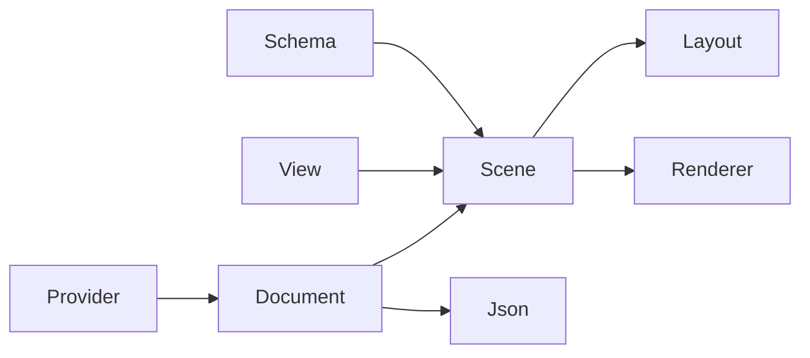

# Graph Explorer — Architecture & API Reference

_Package `com.cashg.graph-explorer` v0.1.0._

Complete **architecture** and **public API** reference for the Graph Explorer Unity library.
Integration guide: [SDK.md](SDK.md).

## Table of contents

1. [Architecture overview](#architecture-overview)
2. [Assemblies & dependencies](#assemblies--dependencies)
3. [Core API (`Cashg.GraphExplorer`)](#core-api-cashggraphexplorer)
4. [Presentation API (`Cashg.GraphExplorer.Presentation`)](#presentation-api-cashggraphexplorerpresentation)
5. [Codex (`Cashg.GraphExplorer.Codex`)](#codex-cashggraphexplorercodex)
6. [Editor (`Cashg.GraphExplorer.Editor`)](#editor-cashggraphexploreditor)
7. [Usage examples](#usage-examples)

## Architecture overview

| Layer            | Types                                              | Responsibility                                 |
|------------------|----------------------------------------------------|------------------------------------------------|
| **Records**      | `GraphNodeRecord`, `GraphEdgeRecord`, `GraphValue` | Immutable facts and metadata                   |
| **Document**     | `GraphDocument`, `GraphBatch`, `GraphTimeline`     | Single-threaded store, atomic updates, history |
| **Schema**       | `GraphSchema`, `*Definition`                       | Type colors, fields, validation hints          |
| **View**         | `GraphViewState`, `GraphNodeViewState`             | Layout, selection, visibility (not in JSON)    |
| **Projection**   | `GraphScene`, `GraphClusterScene`, `IGraphNode`    | Live facades for layout/render/UI              |
| **IO**           | `GraphJson`, `GraphStorage`                        | Portable files; view state excluded            |
| **Providers**    | `IGraphDataProvider`, `IGraphActionProvider`       | Host-owned backends (coroutines)               |
| **Presentation** | `ForceLayout`, `GraphRenderer`, presenters         | URP + UI Toolkit                               |



**Rules worth remembering:**

- IDs are opaque, case-sensitive strings; no auto-deduplication.
- `Apply` validates the whole batch; conflicting ops roll back entirely.
- Editing while timeline is historical auto-returns to live (`EnsureLive`).
- Layout proximity is not evidence of a semantic edge.

## Assemblies & dependencies

| Assembly                           | Unity deps                 | Notes                        |
|------------------------------------|----------------------------|------------------------------|
| `Cashg.GraphExplorer`              | Core, `System.Text.Json`   | Safe for non-URP tools       |
| `Cashg.GraphExplorer.Presentation` | URP 17.7, Input System 7.0 | Player + Editor              |
| `Cashg.GraphExplorer.Editor`       | Editor only                | Do not reference from player |

---

## Core API (`Cashg.GraphExplorer`)

### `Runtime/GraphClusterScene.cs`

Namespace: `Cashg.GraphExplorer`

#### `GraphClusterScene` (class)

A reversible presentation of a source scene. The source document is never changed.

| Member                      | Declaration                                                                                                                                                   |
|-----------------------------|---------------------------------------------------------------------------------------------------------------------------------------------------------------|
| `"graph-explorer:cluster";` | `public const string ClusterType = "graph-explorer:cluster";`                                                                                                 |
| `source.Document;`          | `public GraphDocument Document => source.Document;`                                                                                                           |
| `source.View;`              | `public GraphViewState View => source.View;`                                                                                                                  |
| `source.Schema;`            | `public GraphSchema Schema => source.Schema;`                                                                                                                 |
| `IReadOnlyDictionary`       | `public IReadOnlyDictionary<string, IGraphNode> Nodes => nodeView;`                                                                                           |
| `IReadOnlyDictionary`       | `public IReadOnlyDictionary<string, IGraphEdge> Edges => edgeView;`                                                                                           |
| `revision;`                 | `public int Revision => revision;`                                                                                                                            |
| `LodEnabled`                | `public bool LodEnabled`                                                                                                                                      |
| `80;`                       | `public float LodEnterDistance { get; set; } = 80;`                                                                                                           |
| `65;`                       | `public float LodExitDistance { get; set; } = 65;`                                                                                                            |
| `12;`                       | `public float LodNeighborSeparation { get; set; } = 12;`                                                                                                      |
| `2;`                        | `public int LodMinimumMembers { get; set; } = 2;`                                                                                                             |
| `IsCluster`                 | `public bool IsCluster(string id) => id != null && clusters.ContainsKey(id);`                                                                                 |
| `IsCollapsed`               | `public bool IsCollapsed(string id) => id != null && clusters.TryGetValue(id, out var cluster) && cluster.Collapsed;`                                         |
| `ParentId`                  | `public string ParentId(string id) => id != null && parents.TryGetValue(id, out var parent) ? parent : null;`                                                 |
| `IReadOnlyList`             | `public IReadOnlyList<string> Children(string id) => clusters.TryGetValue(id, out var cluster) ? Array.AsReadOnly(cluster.Children) : Array.Empty<string>();` |
| `IReadOnlyList`             | `public IReadOnlyList<GraphNodeRecord> MemberRecords(string id) =>`                                                                                           |
| `Collapse`                  | `public string Collapse(IEnumerable<string> memberIds, string label = null)`                                                                                  |
| `Expand`                    | `public bool Expand(string id) => Expand(id, true);`                                                                                                          |
| `ClearLodOverrides`         | `public void ClearLodOverrides() => lodSuppressed.Clear();`                                                                                                   |

### `Runtime/GraphDocument.cs`

Namespace: `Cashg.GraphExplorer`

#### `GraphIdSet` (class)

Read-only live set, without exposing the mutable adjacency collection.

| Member          | Declaration                                                             |
|-----------------|-------------------------------------------------------------------------|
| `Values.Count;` | `public int Count => Values.Count;`                                     |
| `Contains`      | `public bool Contains(string id) => Values.Contains(id);`               |
| `IEnumerator`   | `public IEnumerator<string> GetEnumerator() => Values.GetEnumerator();` |

#### `GraphDocument` (class)

Dataset-neutral facts and indexes. Single-threaded; apply provider results on the owner thread.

| Member                 | Declaration                                                                                                                                    |
|------------------------|------------------------------------------------------------------------------------------------------------------------------------------------|
| `IReadOnlyDictionary`  | `public IReadOnlyDictionary<string, GraphNodeRecord> Nodes`                                                                                    |
| `IReadOnlyDictionary`  | `public IReadOnlyDictionary<string, GraphEdgeRecord> Edges`                                                                                    |
| `DatasetId`            | `public string DatasetId`                                                                                                                      |
| `DisplayName`          | `public string DisplayName`                                                                                                                    |
| `Revision`             | `public int Revision`                                                                                                                          |
| `TopologyRevision`     | `public int TopologyRevision`                                                                                                                  |
| `GraphTimeline`        | `public GraphTimeline Timeline { get; } = new GraphTimeline();`                                                                                |
| `Changed;`             | `public event Action Changed;`                                                                                                                 |
| `GraphDocument`        | `public GraphDocument(string datasetId, string displayName = "")`                                                                              |
| `Neighbors`            | `public GraphIdSet Neighbors(string id) => adjacency[id].Neighbors;`                                                                           |
| `IncidentEdges`        | `public GraphIdSet IncidentEdges(string id) => adjacency[id].Edges;`                                                                           |
| `Snapshot`             | `public GraphSnapshot Snapshot() => new GraphSnapshot(DatasetId, DisplayName, nodes.Values, edges.Values);`                                    |
| `EstablishBaseline`    | `public void EstablishBaseline(DateTimeOffset? timestampUtc = null) => Timeline.EstablishBaseline(Snapshot(), timestampUtc);`                  |
| `RecordPositionFrame`  | `public void RecordPositionFrame(IEnumerable<KeyValuePair<string, UnityEngine.Vector3>> positions, DateTimeOffset? timestampUtc = null)`       |
| `ClearPositionHistory` | `public void ClearPositionHistory() => Timeline.ClearPositionHistory();`                                                                       |
| `ClearEventHistory`    | `public void ClearEventHistory(DateTimeOffset? timestampUtc = null) => Timeline.ClearEventHistory(Snapshot(), timestampUtc);`                  |
| `ClearHistory`         | `public void ClearHistory(DateTimeOffset? timestampUtc = null) => Timeline.ClearEventHistory(Snapshot(), timestampUtc, clearPositions: true);` |
| `ReturnToLive`         | `public void ReturnToLive() => Seek(Timeline.LatestTimeUtc);`                                                                                  |

### `Runtime/GraphJson.cs`

Namespace: `Cashg.GraphExplorer`

#### `GraphJson` (class)

Versioned semantic document format. View state and application credentials are not included.

_See source for properties; interface/MonoBehaviour members may be split across partial declarations._

### `Runtime/GraphPathfinder.cs`

Namespace: `Cashg.GraphExplorer`

#### `GraphPathEndpoint` (enum)

_Enum constants — see source file._

#### `GraphPathfinder` (class)

Unweighted, directed shortest paths over the currently projected scene.

_See source for properties; interface/MonoBehaviour members may be split across partial declarations._

#### `GraphPathResult` (class)

| Member           | Declaration                                     |
|------------------|-------------------------------------------------|
| `StartId`        | `public string StartId`                         |
| `EndId`          | `public string EndId`                           |
| `IReadOnlyList`  | `public IReadOnlyList<string> NodeIds`          |
| `IReadOnlyList`  | `public IReadOnlyList<string> EdgeIds`          |
| `0;`             | `public bool IsReachable => NodeIds.Count > 0;` |
| `EdgeIds.Count;` | `public int Jumps => EdgeIds.Count;`            |

#### `GraphPathState` (class)

Persistent path selection state. Call Synchronize after scene topology changes.

| Member           | Declaration                                                                                  |
|------------------|----------------------------------------------------------------------------------------------|
| `IsActive`       | `public bool IsActive`                                                                       |
| `Result`         | `public GraphPathResult Result`                                                              |
| `StartId`        | `public string StartId`                                                                      |
| `EndId`          | `public string EndId`                                                                        |
| `PendingPick`    | `public GraphPathEndpoint? PendingPick`                                                      |
| `Action`         | `public event Action<GraphPathState> Changed;`                                               |
| `Action`         | `public event Action<GraphPathEndpoint> PickRequested;`                                      |
| `GraphPathState` | `public GraphPathState(IGraphScene scene, Func<IGraphEdge, bool> edgeAllowed = null)`        |
| `Show`           | `public GraphPathResult Show(string startId, string endId) => SetEndpoints(startId, endId);` |
| `BeginPick`      | `public void BeginPick(GraphPathEndpoint endpoint)`                                          |
| `CancelPick`     | `public void CancelPick()`                                                                   |
| `Synchronize`    | `public bool Synchronize(bool force = false)`                                                |

### `Runtime/GraphPresentationContracts.cs`

Namespace: `Cashg.GraphExplorer`

#### `LayoutMode` (enum)

_Enum constants — see source file._

#### `SizeMapping` (enum)

_Enum constants — see source file._

#### `ColorMapping` (enum)

_Enum constants — see source file._

#### `ToolEmphasis` (enum)

_Enum constants — see source file._

#### `IGraphNode` (interface)

A live projection, not a second semantic document. Hosts may implement richer facades.

_See source for properties; interface/MonoBehaviour members may be split across partial declarations._

#### `IGraphEdge` (interface)

Live edge facade over `GraphEdgeRecord`.

_See source for properties; interface/MonoBehaviour members may be split across partial declarations._

#### `IGraphScene` (interface)

Document + schema + projected node/edge maps + topology revision.

_See source for properties; interface/MonoBehaviour members may be split across partial declarations._

#### `IGraphEdgeFilter` (interface)

Host predicate to hide edge types from layout/render/pick.

_See source for properties; interface/MonoBehaviour members may be split across partial declarations._

#### `GraphPresentationProfile` (class)

Optional domain policies. Missing policies give ordinary type/degree exploration.

| Member | Declaration                                           |
|--------|-------------------------------------------------------|
| `"";`  | `public string MetricField = "", CategoryField = "";` |
| `Func` | `public Func<IGraphNode, bool> MetricApplies;`        |
| `Func` | `public Func<IGraphNode, bool> CategoryApplies;`      |
| `Func` | `public Func<IGraphNode, Color?> CategoryFallback;`   |
| `Func` | `public Func<float, Color> MetricColor = Spectrum;`   |
| `Func` | `public Func<IGraphNode, bool> IsGroupAnchor;`        |
| `Func` | `public Func<IGraphNode, string> GroupId;`            |
| `Func` | `public Func<IGraphNode, float> GroupStrength;`       |
| `Func` | `public Func<IGraphNode, float?> Lane;`               |
| `16;`  | `public float LaneCenter, LaneSpacing = 16;`          |

#### `GraphNodeProgressVisual` (class)

Host-owned progress. A fraction of one does not imply validated completion.

| Member     | Declaration             |
|------------|-------------------------|
| `Fraction` | `public float Fraction` |
| `Complete` | `public bool Complete`  |

#### `GraphTaskVisual` (class)

| Member      | Declaration                                                                                                          |
|-------------|----------------------------------------------------------------------------------------------------------------------|
| `"";`       | `public string Status = "draft", Text = "";`                                                                         |
| `Progress;` | `public float? Progress;`                                                                                            |
| `Done;`     | `public int Count, Done;`                                                                                            |
| `Color`     | `public static Color Color(string status) => status == "failed" \|\| status == "blocked" ? new Color(1,.35f,.35f) :` |

### `Runtime/GraphProviders.cs`

Namespace: `Cashg.GraphExplorer`

#### `GraphProviderProgress` (class)

| Member                  | Declaration                                                             |
|-------------------------|-------------------------------------------------------------------------|
| `Message`               | `public string Message`                                                 |
| `Fraction`              | `public double? Fraction`                                               |
| `GraphProviderProgress` | `public GraphProviderProgress(string message, double? fraction = null)` |

#### `IGraphDataProvider` (interface)

Coroutine-based load of snapshots and incremental detail batches.

_See source for properties; interface/MonoBehaviour members may be split across partial declarations._

#### `GraphActionParameter` (class)

| Member        | Declaration                  |
|---------------|------------------------------|
| `Id`          | `public string Id`           |
| `Label`       | `public string Label`        |
| `Description` | `public string Description`  |
| `Type`        | `public GraphValueType Type` |
| `Required`    | `public bool Required`       |

#### `GraphActionDefinition` (class)

| Member                | Declaration                                                                                      |
|-----------------------|--------------------------------------------------------------------------------------------------|
| `Id`                  | `public string Id`                                                                               |
| `Label`               | `public string Label`                                                                            |
| `Description`         | `public string Description`                                                                      |
| `List`                | `public List<string> AcceptedTypeIds { get; set; } = new List<string>();`                        |
| `List`                | `public List<GraphActionParameter> Parameters { get; set; } = new List<GraphActionParameter>();` |
| `ConfigurationSchema` | `public JsonElement ConfigurationSchema`                                                         |

#### `GraphActionRequest` (class)

| Member         | Declaration                                                                                              |
|----------------|----------------------------------------------------------------------------------------------------------|
| `NewGuid`      | `public string Id { get; set; } = Guid.NewGuid().ToString("N");`                                         |
| `ActionId`     | `public string ActionId`                                                                                 |
| `SourceNodeId` | `public string SourceNodeId`                                                                             |
| `TargetId`     | `public string TargetId`                                                                                 |
| `Dictionary`   | `public Dictionary<string, GraphValue> Binding { get; set; } = new Dictionary<string, GraphValue>();`    |
| `Dictionary`   | `public Dictionary<string, GraphValue> Parameters { get; set; } = new Dictionary<string, GraphValue>();` |
| `Payload`      | `public JsonElement Payload`                                                                             |

#### `GraphActionEntryProgress` (class)

| Member      | Declaration                                                        |
|-------------|--------------------------------------------------------------------|
| `RequestId` | `public string RequestId`                                          |
| `Status`    | `public string Status`                                             |
| `Message`   | `public string Message`                                            |
| `Fraction`  | `public double? Fraction`                                          |
| `List`      | `public List<string> Errors { get; set; } = new List<string>();`   |
| `List`      | `public List<string> Warnings { get; set; } = new List<string>();` |

#### `GraphActionRun` (class)

| Member        | Declaration                                                                                           |
|---------------|-------------------------------------------------------------------------------------------------------|
| `Id`          | `public string Id`                                                                                    |
| `ReviewToken` | `public string ReviewToken`                                                                           |
| `Status`      | `public string Status`                                                                                |
| `Revision`    | `public long Revision`                                                                                |
| `List`        | `public List<GraphActionEntryProgress> Entries { get; set; } = new List<GraphActionEntryProgress>();` |
| `Payload`     | `public JsonElement Payload`                                                                          |

#### `GraphProviderException` (class)

| Member                   | Declaration                                                                        |
|--------------------------|------------------------------------------------------------------------------------|
| `ResponseCode`           | `public long ResponseCode`                                                         |
| `ResponseCode`           | `public bool Rejected => ResponseCode >= 400 && ResponseCode < 500;`               |
| `GraphProviderException` | `public GraphProviderException(string message, long responseCode) : base(message)` |

#### `IGraphActionProvider` (interface)

Review/execute/recover/control for queued graph actions.

| Member          | Declaration                                             |
|-----------------|---------------------------------------------------------|
| `IReadOnlyList` | `IReadOnlyList<GraphActionRequest> ResolveTargets(...)` |
| `Recover`       | `IEnumerator Recover(...)`                              |
| `Refresh`       | `IEnumerator Refresh(...)`                              |
| `Control`       | `IEnumerator Control(...)`                              |

#### `IGraphActionHistoryProvider` (interface)

Optional catalog of action definitions and past runs.

| Member        | Declaration                    |
|---------------|--------------------------------|
| `LoadActions` | `IEnumerator LoadActions(...)` |
| `ListRuns`    | `IEnumerator ListRuns(...)`    |

### `Runtime/GraphQueueCoordinator.cs`

Namespace: `Cashg.GraphExplorer`

#### `GraphQueueCoordinator` (class)

Single-flight wrapper for action provider review/execute/recover.

| Member | Declaration        |
|--------|--------------------|
| `Busy` | `public bool Busy` |

### `Runtime/GraphRecords.cs`

Namespace: `Cashg.GraphExplorer`

#### `GraphValueType` (enum)

Discriminator for scalar metadata stored on nodes and edges.

_Enum constants — see source file._

#### `GraphValue` (struct)

Portable scalar metadata. Numbers are finite; null differs from missing.

| Member          | Declaration                                                                                                                                                                        |
|-----------------|------------------------------------------------------------------------------------------------------------------------------------------------------------------------------------|
| `Type`          | `public GraphValueType Type`                                                                                                                                                       |
| `Text`          | `public string Text`                                                                                                                                                               |
| `Number`        | `public double Number`                                                                                                                                                             |
| `Boolean`       | `public bool Boolean`                                                                                                                                                              |
| `default;`      | `public static GraphValue Null => default;`                                                                                                                                        |
| `From`          | `public static GraphValue From(string value) => value == null ? Null : new GraphValue(GraphValueType.Text, text: value);`                                                          |
| `From`          | `public static GraphValue From(bool value) => new GraphValue(GraphValueType.Boolean, boolean: value);`                                                                             |
| `ToString`      | `public override string ToString() => Type == GraphValueType.Text ? Text :`                                                                                                        |
| `Equals`        | `public bool Equals(GraphValue other) => Type == other.Type && Text == other.Text && Number == other.Number && Boolean == other.Boolean;`                                          |
| `Equals`        | `public override bool Equals(object obj) => obj is GraphValue other && Equals(other);`                                                                                             |
| `GetHashCode`   | `public override int GetHashCode() => HashCode.Combine(Type, Text, Number, Boolean);`                                                                                              |
| `Required`      | `public static string Required(string value, string name) => !string.IsNullOrWhiteSpace(value) ? value : throw new ArgumentException("An opaque nonempty ID is required.", name);` |
| `IReadOnlyList` | `public static IReadOnlyList<string> Sources(IEnumerable<string> values) => Array.AsReadOnly(`                                                                                     |

#### `GraphNodeRecord` (class)

Immutable semantic facts. Layout, filters and selection belong to GraphViewState.

| Member                | Declaration                                                                                                                                                                            |
|-----------------------|----------------------------------------------------------------------------------------------------------------------------------------------------------------------------------------|
| `Id`                  | `public string Id`                                                                                                                                                                     |
| `TypeId`              | `public string TypeId`                                                                                                                                                                 |
| `Label`               | `public string Label`                                                                                                                                                                  |
| `IReadOnlyDictionary` | `public IReadOnlyDictionary<string, GraphValue> Properties`                                                                                                                            |
| `IReadOnlyList`       | `public IReadOnlyList<string> Sources`                                                                                                                                                 |
| `WithIdentity`        | `public GraphNodeRecord WithIdentity(string typeId, string label) => new GraphNodeRecord(Id, typeId, label, GraphRecordCopy.Properties(Properties), Sources);`                         |
| `WithSources`         | `public GraphNodeRecord WithSources(IEnumerable<string> sources) => new GraphNodeRecord(Id, TypeId, Label, GraphRecordCopy.Properties(Properties), GraphRecordCopy.Sources(sources));` |

#### `GraphEdgeRecord` (class)

Immutable directed edge between existing node IDs.

| Member                | Declaration                                                                                                                       |
|-----------------------|-----------------------------------------------------------------------------------------------------------------------------------|
| `Id`                  | `public string Id`                                                                                                                |
| `From`                | `public string From`                                                                                                              |
| `To`                  | `public string To`                                                                                                                |
| `TypeId`              | `public string TypeId`                                                                                                            |
| `Status`              | `public string Status`                                                                                                            |
| `Confidence`          | `public double? Confidence`                                                                                                       |
| `IReadOnlyDictionary` | `public IReadOnlyDictionary<string, GraphValue> Properties`                                                                       |
| `IReadOnlyList`       | `public IReadOnlyList<string> Sources`                                                                                            |
| `GraphEdgeRecord`     | `public GraphEdgeRecord(string id, string from, string to, string typeId, string status = "observed", double? confidence = null,` |
| `WithEvidence`        | `public GraphEdgeRecord WithEvidence(double? confidence, IEnumerable<string> sources) =>`                                         |

#### `GraphSnapshot` (class)

Complete dataset payload: id, display name, all nodes and edges.

| Member          | Declaration                                   |
|-----------------|-----------------------------------------------|
| `DatasetId`     | `public string DatasetId`                     |
| `DisplayName`   | `public string DisplayName`                   |
| `IReadOnlyList` | `public IReadOnlyList<GraphNodeRecord> Nodes` |
| `IReadOnlyList` | `public IReadOnlyList<GraphEdgeRecord> Edges` |

#### `GraphBatch` (class)

One atomic update: upserts replace facts; node removal also removes incident edges.

| Member | Declaration                                                                  |
|--------|------------------------------------------------------------------------------|
| `List` | `public readonly List<GraphNodeRecord> Nodes = new List<GraphNodeRecord>();` |
| `List` | `public readonly List<GraphEdgeRecord> Edges = new List<GraphEdgeRecord>();` |
| `List` | `public readonly List<string> RemoveNodes = new List<string>();`             |
| `List` | `public readonly List<string> RemoveEdges = new List<string>();`             |

### `Runtime/GraphRevisionTimeline.cs`

Namespace: `Cashg.GraphExplorer`

#### `GraphRevision` (class)

A discrete revision from a source control DAG. Timestamps are descriptive, not seek coordinates.

| Member          | Declaration                                                                                                            |
|-----------------|------------------------------------------------------------------------------------------------------------------------|
| `Id`            | `public string Id`                                                                                                     |
| `IReadOnlyList` | `public IReadOnlyList<string> ParentIds`                                                                               |
| `TimestampUtc`  | `public DateTimeOffset? TimestampUtc`                                                                                  |
| `Label`         | `public string Label`                                                                                                  |
| `Lane`          | `public int Lane`                                                                                                      |
| `LaneGlyphs`    | `public string LaneGlyphs`                                                                                             |
| `LaneCount`     | `public int LaneCount`                                                                                                 |
| `IReadOnlyList` | `public IReadOnlyList<GraphRevisionLaneLink> LaneLinks { get; internal set; } = Array.Empty<GraphRevisionLaneLink>();` |
| `Ready`         | `public bool Ready`                                                                                                    |
| `Changes`       | `public GraphRevisionChangeSummary Changes`                                                                            |

#### `GraphRevisionLaneLink` (struct)

| Member                  | Declaration                                              |
|-------------------------|----------------------------------------------------------|
| `FromLane`              | `public int FromLane`                                    |
| `ToLane`                | `public int ToLane`                                      |
| `GraphRevisionLaneLink` | `public GraphRevisionLaneLink(int fromLane, int toLane)` |

#### `GraphRevisionChangeSummary` (class)

| Member          | Declaration                                                                                   |
|-----------------|-----------------------------------------------------------------------------------------------|
| `NodesCreated`  | `public int NodesCreated`                                                                     |
| `NodesModified` | `public int NodesModified`                                                                    |
| `NodesDeleted`  | `public int NodesDeleted`                                                                     |
| `EdgesCreated`  | `public int EdgesCreated`                                                                     |
| `EdgesModified` | `public int EdgesModified`                                                                    |
| `EdgesDeleted`  | `public int EdgesDeleted`                                                                     |
| `IReadOnlyList` | `public IReadOnlyList<string> CreatedNodeIds { get; private set; } = Array.Empty<string>();`  |
| `IReadOnlyList` | `public IReadOnlyList<string> ModifiedNodeIds { get; private set; } = Array.Empty<string>();` |
| `IReadOnlyList` | `public IReadOnlyList<string> DeletedNodeIds { get; private set; } = Array.Empty<string>();`  |
| `IReadOnlyList` | `public IReadOnlyList<string> CreatedEdgeIds { get; private set; } = Array.Empty<string>();`  |
| `IReadOnlyList` | `public IReadOnlyList<string> ModifiedEdgeIds { get; private set; } = Array.Empty<string>();` |
| `IReadOnlyList` | `public IReadOnlyList<string> DeletedEdgeIds { get; private set; } = Array.Empty<string>();`  |

#### `GraphRevisionTimeline` (class)

Revision ordering and branch lanes; snapshot loading is owned by the host.

| Member          | Declaration                                                                                              |
|-----------------|----------------------------------------------------------------------------------------------------------|
| `IReadOnlyList` | `public IReadOnlyList<GraphRevision> Revisions => revisions;`                                            |
| `Selected`      | `public GraphRevision Selected`                                                                          |
| `Changed;`      | `public event Action Changed;`                                                                           |
| `Action`        | `public event Action<GraphRevision> SelectionRequested;`                                                 |
| `TryGet`        | `public bool TryGet(string id, out GraphRevision revision) => byId.TryGetValue(id ?? "", out revision);` |

### `Runtime/GraphScene.cs`

Namespace: `Cashg.GraphExplorer`

#### `GraphDictionaryView` (class)

Covariant dictionary view. Identity and ownership stay with the source.

| Member                | Declaration                                                               |
|-----------------------|---------------------------------------------------------------------------|
| `GraphDictionaryView` | `public GraphDictionaryView(IReadOnlyDictionary<string, TSource> source)` |
| `IEnumerable`         | `public IEnumerable<string> Keys => source.Keys;`                         |
| `IEnumerable`         | `public IEnumerable<T> Values`                                            |
| `source.Count;`       | `public int Count => source.Count;`                                       |
| `ContainsKey`         | `public bool ContainsKey(string id) => source.ContainsKey(id);`           |
| `TryGetValue`         | `public bool TryGetValue(string id, out T value)`                         |
| `IEnumerator`         | `public IEnumerator<KeyValuePair<string, T>> GetEnumerator()`             |

#### `GraphScene` (class)

Default document/view projection for hosts that do not need domain facades.

| Member                       | Declaration                                                                                 |
|------------------------------|---------------------------------------------------------------------------------------------|
| `Document`                   | `public GraphDocument Document`                                                             |
| `View`                       | `public GraphViewState View`                                                                |
| `Schema`                     | `public GraphSchema Schema`                                                                 |
| `IReadOnlyDictionary`        | `public IReadOnlyDictionary<string, IGraphNode> Nodes`                                      |
| `IReadOnlyDictionary`        | `public IReadOnlyDictionary<string, IGraphEdge> Edges`                                      |
| `Document.TopologyRevision;` | `public int Revision => Document.TopologyRevision;`                                         |
| `GraphScene`                 | `public GraphScene(GraphDocument document, GraphSchema schema, GraphViewState view = null)` |

### `Runtime/GraphSchema.cs`

Namespace: `Cashg.GraphExplorer`

#### `GraphCategoryDefinition` (class)

Presentation metadata for one discrete value of a categorical <see cref="GraphFieldDefinition"/>. Keys
in <see cref="GraphFieldDefinition.Categories"/> are the raw stored property values; lookup
uses <see cref="GraphValue.ToString"/> (see <see cref="GraphPresentationProfile.CategoryColor"/>).

| Member                    | Declaration                                                                                   |
|---------------------------|-----------------------------------------------------------------------------------------------|
| `Label`                   | `public string Label`                                                                         |
| `Color`                   | `public Color Color`                                                                          |
| `Badge`                   | `public string Badge`                                                                         |
| `Order`                   | `public int Order`                                                                            |
| `GraphCategoryDefinition` | `public GraphCategoryDefinition(string label, Color color, string badge = "", int order = 0)` |

#### `GraphFieldDefinition` (class)

Human-readable name for legends, filters and inspectors. Node color when <see cref="ColorMapping.Category"/> is active
for the owning field. Optional short glyph or abbreviation for compact UI; empty when omitted. Relative sort order when
listing categories (lower values first). Creates a category definition for schema registration. <param name="label">
Display name; null becomes empty.</param> <param name="color">Color used for category-based node
coloring.</param> <param name="badge">Optional compact label; null becomes empty.</param> <param name="order">Sort key
for ordered category lists; default is zero.</param>  Schema entry for a node or edge property key. Documents may carry
undeclared properties; registration enables validation, search or filter policy, inspector visibility, and presentation
helpers.

| Member                 | Declaration                                                                                       |
|------------------------|---------------------------------------------------------------------------------------------------|
| `Id`                   | `public string Id`                                                                                |
| `Label`                | `public string Label`                                                                             |
| `Type`                 | `public GraphValueType Type`                                                                      |
| `Searchable`           | `public bool Searchable`                                                                          |
| `Inspectable`          | `public bool Inspectable`                                                                         |
| `Unit`                 | `public string Unit`                                                                              |
| `PartitionBy`          | `public string PartitionBy`                                                                       |
| `IReadOnlyDictionary`  | `public IReadOnlyDictionary<string, GraphCategoryDefinition> Categories`                          |
| `GraphFieldDefinition` | `public GraphFieldDefinition(string id, string label, GraphValueType type = GraphValueType.Text,` |

#### `GraphNodeTypeDefinition` (class)

Stable property key; matches keys in <see cref="GraphNodeRecord.Properties"/>
and <see cref="GraphEdgeRecord.Properties"/>. Human-readable caption; defaults to <see cref="Id"/> when omitted.
Expected <see cref="GraphValue.Type"/> for non-null values; checked by <see cref="GraphSchema.Validate"/>. When false,
hosts should omit this field from search indexing and query UI. When false, the stock inspector skips this property (see
presenter field gating). Optional display suffix for numeric values (for example a currency or distance unit). When set,
names another property whose value partitions metric scaling for <see cref="GraphPresentationProfile.TryMetric"/>.
Optional map from stored categorical values to <see cref="GraphCategoryDefinition"/> metadata. Registers a field
definition for schema lookup and validation. <param name="id">Non-empty property key.</param> <param name="label">
Display label; null falls back to <paramref name="id"/>.</param> <param name="type">Expected value type for declared
properties.</param> <param name="searchable">Whether search UI should include this
field.</param> <param name="inspectable">Whether the inspector should list this field.</param> <param name="unit">
Optional unit suffix; null becomes empty.</param> <param name="partitionBy">Optional partition property id; null becomes
empty.</param> <param name="categories">Optional categorical value map; null yields an empty read-only
dictionary.</param>  Presentation and default sizing for a node <see cref="GraphNodeRecord.TypeId"/>. Unknown types may
still render via <see cref="GraphPresentationProfile.Type"/> fallbacks.

| Member                    | Declaration                                                                                                                            |
|---------------------------|----------------------------------------------------------------------------------------------------------------------------------------|
| `Id`                      | `public string Id`                                                                                                                     |
| `Label`                   | `public string Label`                                                                                                                  |
| `ShapeId`                 | `public string ShapeId`                                                                                                                |
| `Color`                   | `public Color Color`                                                                                                                   |
| `DefaultRadius`           | `public float DefaultRadius`                                                                                                           |
| `GraphNodeTypeDefinition` | `public GraphNodeTypeDefinition(string id, string label, string shapeId = "default", Color? color = null, float defaultRadius = .65f)` |

#### `GraphRelationDefinition` (class)

Stable type id stored on each node record. Human-readable type name; defaults to <see cref="Id"/> when omitted. Built-in
mesh id for instanced rendering (for example <c>Building</c>, <c>Person</c>); unknown ids fall back at draw time. Node
color when <see cref="ColorMapping.Type"/> is active. Default world-space radius multiplier before metric or degree
sizing overrides. Creates a node type definition for schema registration. <param name="id">Non-empty type
id.</param> <param name="label">Display label; null falls back to <paramref name="id"/>.</param> <param name="shapeId">
Renderer shape id; null becomes <c>default</c>.</param> <param name="color">Type color; null becomes
gray.</param> <param name="defaultRadius">Positive default radius; NaN, infinity, or non-positive values
throw.</param> <exception cref="ArgumentOutOfRangeException"><paramref name="defaultRadius"/> is not finite and
positive.</exception>  Presentation and layout metadata for an edge <see cref="GraphEdgeRecord.TypeId"/>.

| Member                    | Declaration                                                                                              |
|---------------------------|----------------------------------------------------------------------------------------------------------|
| `Id`                      | `public string Id`                                                                                       |
| `Label`                   | `public string Label`                                                                                    |
| `Color`                   | `public Color Color`                                                                                     |
| `IsHierarchy`             | `public bool IsHierarchy`                                                                                |
| `ParentIsFrom`            | `public bool ParentIsFrom`                                                                               |
| `SpringStrength`          | `public float SpringStrength`                                                                            |
| `GraphRelationDefinition` | `public GraphRelationDefinition(string id, string label, Color? color = null, bool isHierarchy = false,` |

#### `GraphSchema` (class)

Stable relation id stored on each edge record. Human-readable relation name; defaults to <see cref="Id"/> when omitted.
Edge line color in the renderer when the relation is registered on the scene schema. When true, marks a parent/child
hierarchy relation for host tree or grouping logic. When <see cref="IsHierarchy"/> is true, parent direction: true means
the <c>From</c> endpoint is the parent; false means the <c>To</c> endpoint is the parent. Force-layout spring weight for
this relation; unregistered relations use a built-in default. Creates a relation definition for schema
registration. <param name="id">Non-empty relation id.</param> <param name="label">Display label; null falls back
to <paramref name="id"/>.</param> <param name="color">Edge color; null becomes gray.</param> <param name="isHierarchy">
Whether this relation denotes a hierarchy.</param> <param name="parentIsFrom">Parent endpoint when hierarchical; ignored
when not hierarchical.</param> <param name="springStrength">Non-negative layout spring strength; NaN or infinity
throw.</param> <exception cref="ArgumentOutOfRangeException"><paramref name="springStrength"/> is not finite and
non-negative.</exception>  Host-supplied meaning and presentation for a graph. <see cref="GraphDocument"/> instances
remain open: they may contain types, relations, and properties not declared here.

| Member                | Declaration                                                             |
|-----------------------|-------------------------------------------------------------------------|
| `IReadOnlyDictionary` | `public IReadOnlyDictionary<string, GraphNodeTypeDefinition> NodeTypes` |
| `IReadOnlyDictionary` | `public IReadOnlyDictionary<string, GraphRelationDefinition> Relations` |
| `IReadOnlyDictionary` | `public IReadOnlyDictionary<string, GraphFieldDefinition> Fields`       |

### `Runtime/GraphStorage.cs`

Namespace: `Cashg.GraphExplorer`

#### `GraphStorage` (class)

Versioned JSON storage. Unknown/corrupt existing documents are never overwritten.

| Member    | Declaration                                                                           |
|-----------|---------------------------------------------------------------------------------------|
| `PathFor` | `public string PathFor(string name) => Path.Combine(directory, Key(name) + ".json");` |

### `Runtime/GraphTimeline.cs`

Namespace: `Cashg.GraphExplorer`

#### `GraphPositionFrame` (class)

One timestamped sample of canonical graph-node positions.

| Member                | Declaration                                                           |
|-----------------------|-----------------------------------------------------------------------|
| `TimestampUtc`        | `public DateTimeOffset TimestampUtc`                                  |
| `IReadOnlyDictionary` | `public IReadOnlyDictionary<string, Vector3> Positions => positions;` |

#### `GraphTimelineChange` (class)

| Member              | Declaration                                         |
|---------------------|-----------------------------------------------------|
| `IReadOnlyList`     | `public IReadOnlyList<GraphNodeRecord> NodesBefore` |
| `IReadOnlyList`     | `public IReadOnlyList<GraphNodeRecord> NodesAfter`  |
| `IReadOnlyList`     | `public IReadOnlyList<GraphEdgeRecord> EdgesBefore` |
| `IReadOnlyList`     | `public IReadOnlyList<GraphEdgeRecord> EdgesAfter`  |
| `DisplayNameBefore` | `public string DisplayNameBefore`                   |
| `DisplayNameAfter`  | `public string DisplayNameAfter`                    |

#### `GraphTimelineEntry` (class)

| Member         | Declaration                          |
|----------------|--------------------------------------|
| `Sequence`     | `public long Sequence`               |
| `TimestampUtc` | `public DateTimeOffset TimestampUtc` |
| `Change`       | `public GraphTimelineChange Change`  |

#### `GraphTimeline` (class)

Persistent, dataset-scoped change history. Baseline facts have no invented creation time.

| Member                   | Declaration                                                                                                                  |
|--------------------------|------------------------------------------------------------------------------------------------------------------------------|
| `GraphTimelineWorkspace` | `public GraphTimelineWorkspace Workspace { get; } = new GraphTimelineWorkspace();`                                           |
| `Baseline`               | `public GraphSnapshot Baseline`                                                                                              |
| `BaselineTimeUtc`        | `public DateTimeOffset BaselineTimeUtc`                                                                                      |
| `IReadOnlyList`          | `public IReadOnlyList<GraphTimelineEntry> Entries => entries.AsReadOnly();`                                                  |
| `IReadOnlyList`          | `public IReadOnlyList<GraphPositionFrame> PositionFrames => positionFrames.AsReadOnly();`                                    |
| `true;`                  | `public bool Enabled { get; set; } = true;`                                                                                  |
| `true;`                  | `public bool PositionRecordingAvailable { get; set; } = true;`                                                               |
| `-1;`                    | `public int Cursor { get; internal set; } = -1;`                                                                             |
| `null;`                  | `public bool HasBaseline => Baseline != null;`                                                                               |
| `0;`                     | `public bool HasPositionHistory => positionFrames.Count > 0;`                                                                |
| `CurrentTimeUtc`         | `public bool IsHistorical => HasBaseline && CurrentTimeUtc < LatestTimeUtc;`                                                 |
| `LatestTimeUtc;`         | `public DateTimeOffset CurrentTimeUtc => hasPlayhead ? playheadTimeUtc : LatestTimeUtc;`                                     |
| `TimestampUtc`           | `public DateTimeOffset EarliestTimeUtc => positionFrames.Count > 0 && positionFrames[0].TimestampUtc < BaselineTimeUtc`      |
| `Changed;`               | `public event Action Changed;`                                                                                               |
| `EstablishBaseline`      | `public void EstablishBaseline(GraphSnapshot snapshot, DateTimeOffset? timestampUtc = null)`                                 |
| `RecordPositionFrame`    | `public void RecordPositionFrame(IEnumerable<KeyValuePair<string, Vector3>> positions, DateTimeOffset? timestampUtc = null)` |

### `Runtime/GraphTimelineEventTrack.cs`

Namespace: `Cashg.GraphExplorer`

#### `GraphTimelineEvent` (class)

An externally loaded state, independent of the document's linear edit history.

| Member               | Declaration                                                                                                                     |
|----------------------|---------------------------------------------------------------------------------------------------------------------------------|
| `Id`                 | `public string Id`                                                                                                              |
| `TimestampUtc`       | `public DateTimeOffset TimestampUtc`                                                                                            |
| `Label`              | `public string Label`                                                                                                           |
| `Details`            | `public string Details`                                                                                                         |
| `Tooltip`            | `public string Tooltip`                                                                                                         |
| `GraphTimelineEvent` | `public GraphTimelineEvent(string id, DateTimeOffset timestampUtc, string label, string details = null, string tooltip = null)` |

#### `GraphTimelineEventTrack` (class)

Optional hover text. Null uses event details; empty disables the tooltip. Host-owned descriptors and asynchronous
selection state. No snapshots are retained here.

| Member                | Declaration                                                                                                                  |
|-----------------------|------------------------------------------------------------------------------------------------------------------------------|
| `IReadOnlyList`       | `public IReadOnlyList<GraphTimelineEvent> Events => events;`                                                                 |
| `Provider`            | `public IGraphTimelineEventProvider Provider`                                                                                |
| `SelectedId`          | `public string SelectedId`                                                                                                   |
| `PendingId`           | `public string PendingId`                                                                                                    |
| `Error`               | `public string Error`                                                                                                        |
| `Revision`            | `public int Revision`                                                                                                        |
| `Changed;`            | `public event Action Changed;`                                                                                               |
| `Action`              | `public event Action<GraphTimelineEvent> SelectionRequested;`                                                                |
| `SelectionStarting;`  | `public event Action SelectionStarting;`                                                                                     |
| `FirstOrDefault`      | `public GraphTimelineEvent Selected => events.FirstOrDefault(item => item.Id == SelectedId);`                                |
| `RestoreCachedEvents` | `public void RestoreCachedEvents(GraphTimelineWorkspace workspace, string context = null) => Replace(workspace.CachedEvents` |
| `RequestSelection`    | `public void RequestSelection(string id, bool stopPlayback = true)`                                                          |
| `CancelPending`       | `public void CancelPending(bool stopPlayback = false)`                                                                       |

### `Runtime/GraphTimelineWorkspace.cs`

Namespace: `Cashg.GraphExplorer`

#### `IGraphTimelineEventProvider` (interface)

Loads exact external event states. Context must change when provider configuration changes.

| Member      | Declaration                  |
|-------------|------------------------------|
| `LoadEvent` | `IEnumerator LoadEvent(...)` |

#### `GraphCachedTimelineEvent` (class)

| Member     | Declaration                       |
|------------|-----------------------------------|
| `Event`    | `public GraphTimelineEvent Event` |
| `Context`  | `public string Context`           |
| `Snapshot` | `public GraphSnapshot Snapshot`   |

#### `GraphTimelineWorkspace` (class)

Dataset-owned timeline selection, absolute zoom window, and portable cached event snapshots.

| Member                        | Declaration                                                                                                                                  |
|-------------------------------|----------------------------------------------------------------------------------------------------------------------------------------------|
| `IReadOnlyCollection`         | `public IReadOnlyCollection<GraphCachedTimelineEvent> CachedEvents => cached.Values;`                                                        |
| `IsCached`                    | `public bool IsCached(string id, string context = null) => context == null ? cachedIds.Contains(id) : cached.ContainsKey(Key(context, id));` |
| `SelectionStartUtc`           | `public DateTimeOffset? SelectionStartUtc`                                                                                                   |
| `SelectionEndUtc`             | `public DateTimeOffset? SelectionEndUtc`                                                                                                     |
| `ViewStartUtc`                | `public DateTimeOffset? ViewStartUtc`                                                                                                        |
| `ViewEndUtc`                  | `public DateTimeOffset? ViewEndUtc`                                                                                                          |
| `SelectionStartUtc.HasValue;` | `public bool HasSelection => SelectionStartUtc.HasValue;`                                                                                    |
| `IsCaching`                   | `public bool IsCaching`                                                                                                                      |
| `Completed`                   | `public int Completed`                                                                                                                       |
| `Total`                       | `public int Total`                                                                                                                           |
| `Error`                       | `public string Error`                                                                                                                        |
| `Changed;`                    | `public event Action Changed;`                                                                                                               |
| `ClearSelection`              | `public void ClearSelection()`                                                                                                               |
| `Contains`                    | `public bool Contains(DateTimeOffset time) => HasSelection && time >= SelectionStartUtc.Value && time <= SelectionEndUtc.Value;`             |
| `IReadOnlyList`               | `public IReadOnlyList<GraphTimelineEvent> SelectedEvents(IEnumerable<GraphTimelineEvent> events) =>`                                         |
| `ClearCache`                  | `public void ClearCache()`                                                                                                                   |

#### `GraphSnapshotCache` (class)

Copies portable state; transient progress and errors are deliberately excluded. Owner drives this coroutine.
Cancellation retains successfully completed events. Bounded LRU for immutable graph snapshots; useful for repeated
parent comparisons.

| Member               | Declaration                                   |
|----------------------|-----------------------------------------------|
| `GraphSnapshotCache` | `public GraphSnapshotCache(int capacity = 8)` |
| `Clear`              | `public void Clear()`                         |

### `Runtime/GraphViewState.cs`

Namespace: `Cashg.GraphExplorer`

#### `GraphNodeViewState` (class)

Per-node layout/filter flags: position, velocity, pinned, visible, matches, favorite, emphasis.

| Member      | Declaration                                                     |
|-------------|-----------------------------------------------------------------|
| `Velocity;` | `public Vector3 Position, Velocity;`                            |
| `Favorite;` | `public bool Pinned, Visible = true, Matches = true, Favorite;` |
| `"";`       | `public string Emphasis = "";`                                  |

#### `GraphViewState` (class)

Per-dataset presentation: positions, selection, focus, fold state.

| Member                | Declaration                                                                                    |
|-----------------------|------------------------------------------------------------------------------------------------|
| `IReadOnlyDictionary` | `public IReadOnlyDictionary<string, GraphNodeViewState> Nodes`                                 |
| `DatasetId`           | `public string DatasetId`                                                                      |
| `"";`                 | `public string SelectedId = "", FocusId = "";`                                                 |
| `HashSet`             | `public readonly HashSet<string> FoldedNodeIds = new HashSet<string>(StringComparer.Ordinal);` |

#### `GraphExplorerOptions` (class)

Render budgets passed to `GraphRenderer`.

| Member                 | Declaration                                                                          |
|------------------------|--------------------------------------------------------------------------------------|
| `NodeRenderBudget`     | `public int NodeRenderBudget`                                                        |
| `NodeLabelBudget`      | `public int NodeLabelBudget`                                                         |
| `GraphExplorerOptions` | `public GraphExplorerOptions(int nodeRenderBudget = 8000, int nodeLabelBudget = 48)` |

### `Runtime/GraphWorkflow.cs`

Namespace: `Cashg.GraphExplorer`

#### `GraphWorkflowState` (enum)

_Enum constants — see source file._

#### `GraphWorkflowGrouping` (enum)

_Enum constants — see source file._

#### `GraphWorkflowStep` (class)

| Member        | Declaration                 |
|---------------|-----------------------------|
| `Id`          | `public string Id`          |
| `Label`       | `public string Label`       |
| `Description` | `public string Description` |

#### `GraphWorkflowValidation` (class)

| Member        | Declaration                                                                                     |
|---------------|-------------------------------------------------------------------------------------------------|
| `NodeId`      | `public string NodeId`                                                                          |
| `StepId`      | `public string StepId`                                                                          |
| `Fingerprint` | `public string Fingerprint`                                                                     |
| `TaskId`      | `public string TaskId`                                                                          |
| `AcceptedUtc` | `public DateTimeOffset AcceptedUtc`                                                             |
| `Dictionary`  | `public Dictionary<string, string> Artifacts { get; set; } = new Dictionary<string, string>();` |

#### `GraphWorkflowTarget` (class)

| Member        | Declaration                                                             |
|---------------|-------------------------------------------------------------------------|
| `NodeId`      | `public string NodeId`                                                  |
| `Fingerprint` | `public string Fingerprint`                                             |
| `List`        | `public List<string> StepIds { get; set; } = new List<string>();`       |
| `List`        | `public List<string> AcceptedSteps { get; set; } = new List<string>();` |

#### `GraphWorkflowTask` (class)

| Member                          | Declaration                                                                                                                                      |
|---------------------------------|--------------------------------------------------------------------------------------------------------------------------------------------------|
| `NewGuid`                       | `public string Id { get; set; } = Guid.NewGuid().ToString("N");`                                                                                 |
| `SourceNodeId`                  | `public string SourceNodeId`                                                                                                                     |
| `IncludeDescendants`            | `public bool IncludeDescendants`                                                                                                                 |
| `List`                          | `public List<GraphWorkflowTarget> Targets { get; set; } = new List<GraphWorkflowTarget>();`                                                      |
| `GraphWorkflowState.Queued;`    | `public GraphWorkflowState State { get; set; } = GraphWorkflowState.Queued;`                                                                     |
| `Prompt`                        | `public string Prompt`                                                                                                                           |
| `ExternalThreadId`              | `public string ExternalThreadId`                                                                                                                 |
| `ExternalTurnId`                | `public string ExternalTurnId`                                                                                                                   |
| `Message`                       | `public string Message`                                                                                                                          |
| `Output`                        | `public string Output`                                                                                                                           |
| `Automatic`                     | `public bool Automatic`                                                                                                                          |
| `DispatchGeneration`            | `public long DispatchGeneration`                                                                                                                 |
| `DispatchedUtc`                 | `public DateTimeOffset? DispatchedUtc`                                                                                                           |
| `FinishedUtc`                   | `public DateTimeOffset? FinishedUtc`                                                                                                             |
| `All`                           | `public bool Accepted => Targets.Count > 0 && Targets.All(t => t.StepIds.All(t.AcceptedSteps.Contains));`                                        |
| `GraphWorkflowState.Cancelled;` | `public bool Unresolved => State != GraphWorkflowState.Complete && State != GraphWorkflowState.Cancelled;`                                       |
| `Join`                          | `public string Key => SourceNodeId + "\|" + IncludeDescendants + "\|" + string.Join(";", Targets.OrderBy(t => t.NodeId, StringComparer.Ordinal)` |

#### `IGraphWorkflowAcceptance` (interface)

Optional host capability; acceptance is separate from external execution success.

| Member      | Declaration           |
|-------------|-----------------------|
| `CanAccept` | `bool CanAccept(...)` |
| `Accept`    | `void Accept(...)`    |

#### `IGraphExternalTaskProvider` (interface)

Optional handoff capability for providers whose work continues outside the graph UI.

| Member             | Declaration                  |
|--------------------|------------------------------|
| `OpenExternalTask` | `void OpenExternalTask(...)` |

#### `GraphWorkflow` (class)

Static helpers mapping workflow states to labels and progress visuals.

| Member  | Declaration                                                                                                   |
|---------|---------------------------------------------------------------------------------------------------------------|
| `Label` | `public static string Label(GraphWorkflowState state) => state == GraphWorkflowState.NotApplicable ? "N/A" :` |

## Presentation API (`Cashg.GraphExplorer.Presentation`)

### `Runtime/Presentation/ForceLayout.cs`

Namespace: `Cashg.GraphExplorer`

#### `ForceLayout` (class)

Bounded, semi-implicit Euler integration with Barnes-Hut octree repulsion.

| Member        | Declaration                                                   |
|---------------|---------------------------------------------------------------|
| `ForceLayout` | `public ForceLayout(GraphPresentationProfile profile = null)` |
| `Mode;`       | `public LayoutMode Mode;`                                     |
| `Paused;`     | `public bool Paused;`                                         |
| `Energy`      | `public float Energy`                                         |
| `1;`          | `public float Temperature { get; private set; } = 1;`         |
| `Reheat`      | `public void Reheat()`                                        |

### `Runtime/Presentation/GraphAtmosphere.cs`

Namespace: `Cashg.GraphExplorer`

#### `GraphAtmosphere` (class)

World-locked cloud banks and a drifting sky dome. Distant graph nodes fade toward the same haze.

| Member            | Declaration                                                                          |
|-------------------|--------------------------------------------------------------------------------------|
| `GraphAtmosphere` | `public GraphAtmosphere(Camera camera, GraphResourceConfiguration resources = null)` |

### `Runtime/Presentation/GraphDiagnostics.cs`

Namespace: `Cashg.GraphExplorer`

#### `GraphDiagnostics` (class)

Stable marker names shared by live profiling and the opt-in baseline runner.

| Member           | Declaration                                                                                          |
|------------------|------------------------------------------------------------------------------------------------------|
| `ProfilerMarker` | `public static readonly ProfilerMarker Update = new ProfilerMarker("GraphExplorer.Update");`         |
| `ProfilerMarker` | `public static readonly ProfilerMarker Layout = new ProfilerMarker("GraphExplorer.Layout");`         |
| `ProfilerMarker` | `public static readonly ProfilerMarker Draw = new ProfilerMarker("GraphExplorer.Draw");`             |
| `ProfilerMarker` | `public static readonly ProfilerMarker Edges = new ProfilerMarker("GraphExplorer.Edges");`           |
| `ProfilerMarker` | `public static readonly ProfilerMarker PickNode = new ProfilerMarker("GraphExplorer.PickNode");`     |
| `ProfilerMarker` | `public static readonly ProfilerMarker PickEdge = new ProfilerMarker("GraphExplorer.PickEdge");`     |
| `ProfilerMarker` | `public static readonly ProfilerMarker NodeLabels = new ProfilerMarker("GraphExplorer.NodeLabels");` |
| `ProfilerMarker` | `public static readonly ProfilerMarker EdgeLabels = new ProfilerMarker("GraphExplorer.EdgeLabels");` |
| `ProfilerMarker` | `public static readonly ProfilerMarker Interface = new ProfilerMarker("GraphExplorer.Interface");`   |
| `ProfilerMarker` | `public static readonly ProfilerMarker Inspector = new ProfilerMarker("GraphExplorer.Inspector");`   |
| `ProfilerMarker` | `public static readonly ProfilerMarker Queue = new ProfilerMarker("GraphExplorer.Queue");`           |

### `Runtime/Presentation/GraphHeaderIcons.cs`

Namespace: `Cashg.GraphExplorer`

#### `HeaderIcons` (class)

Interface glyphs from Font Awesome Free 6.7.2 by @fontawesome (https://fontawesome.com). Icons: CC BY 4.0. Fonts: SIL
OFL 1.1. Code: MIT. Copyright 2024 Fonticons, Inc. https://fontawesome.com/license/free

| Member  | Declaration                                                              |
|---------|--------------------------------------------------------------------------|
| `Paint` | `public static void Paint(Painter2D painter, string icon, Rect rect) =>` |

### `Runtime/Presentation/GraphNavigation.cs`

Namespace: `Cashg.GraphExplorer`

#### `GraphNavigation` (class)

Orbit/fly/pan camera controller (Input System).

| Member      | Declaration                                                                       |
|-------------|-----------------------------------------------------------------------------------|
| `22;`       | `public float Speed = 22;`                                                        |
| `orbiting;` | `public bool Looking => looking \|\| orbiting;`                                   |
| `tracking;` | `public bool Tracking => tracking;`                                               |
| `null;`     | `public IGraphNode Tracked => tracking ? subject : null;`                         |
| `Focus`     | `public void Focus(IGraphNode node, float radius = 12)`                           |
| `Frame`     | `public void Frame(Vector3 center, float radius = 12)`                            |
| `Tick`      | `public void Tick(bool blocked, IGraphNode selected, bool frameSelected = false)` |
| `Dispose`   | `public void Dispose()`                                                           |

### `Runtime/Presentation/GraphNodeEffects.cs`

Namespace: `Cashg.GraphExplorer`

#### `GraphNodeEffects` (class)

Camera-local, node-only outlines and bloom. No scene-wide post-process volume.

| Member                       | Declaration                                                                                     |
|------------------------------|-------------------------------------------------------------------------------------------------|
| `Settings;`                  | `public GraphVisualSettings Settings;`                                                          |
| `Renderer`                   | `public GraphRenderer Renderer`                                                                 |
| `GraphResourceConfiguration` | `public GraphResourceConfiguration Resources { get; set; } = new GraphResourceConfiguration();` |

### `Runtime/Presentation/GraphNodeLabelSettings.cs`

Namespace: `Cashg.GraphExplorer`

#### `GraphNodeLabelSettings` (class)

| Member  | Declaration                                                     |
|---------|-----------------------------------------------------------------|
| `true;` | `public bool MouseProximityReveal = true;`                      |
| `true;` | `public bool KeepSelectedLabelVisible = true;`                  |
| `Color` | `public Color BackgroundColor = new Color(.02f,.03f,.05f,.5f);` |

### `Runtime/Presentation/GraphNodeModels.cs`

Namespace: `Cashg.GraphExplorer`

#### `GraphNodeModels` (class)

One reusable low-poly mesh per entity kind, shared by all its instances.

| Member   | Declaration                                                                              |
|----------|------------------------------------------------------------------------------------------|
| `Create` | `public static Mesh Create(string shapeId, GraphResourceConfiguration resources = null)` |

### `Runtime/Presentation/GraphPathPresenter.cs`

Namespace: `Cashg.GraphExplorer`

#### `GraphPathRendering` (class)

_See source for properties; interface/MonoBehaviour members may be split across partial declarations._

#### `GraphPathPresenter` (class)

Keep the renderer's persistent path in sync with path state; dispose on teardown. Compact reusable UI Toolkit path
panel. Hosts route pick requests into their graph input.

| Member    | Declaration             |
|-----------|-------------------------|
| `Dispose` | `public void Dispose()` |

### `Runtime/Presentation/GraphQueueView.cs`

Namespace: `Cashg.GraphExplorer`

#### `GraphQueueView` (class)

Queue visuals and editing gestures; providers retain review/execution authority.

| Member      | Declaration                                                                                                                        |
|-------------|------------------------------------------------------------------------------------------------------------------------------------|
| `CreateRow` | `public static Row CreateRow(VisualElement parent, string id, int position, string title, Color accent, bool highlighted = false)` |

### `Runtime/Presentation/GraphRenderer.cs`

Namespace: `Cashg.GraphExplorer`

#### `GraphRenderer` (class)

Instanced node meshes; a single dynamic line mesh for edges. No per-node GameObjects.

| Member                      | Declaration                                                                                                                                       |
|-----------------------------|---------------------------------------------------------------------------------------------------------------------------------------------------|
| `SizeMapping.Connections;`  | `public SizeMapping Size = SizeMapping.Connections;`                                                                                              |
| `ColorMapping.Type;`        | `public ColorMapping ColorBy = ColorMapping.Type;`                                                                                                |
| `8000;`                     | `public int MaximumVisible = 8000;`                                                                                                               |
| `VisibleDegree;`            | `public bool VisibleDegree;`                                                                                                                      |
| `VisibleCount`              | `public int VisibleCount`                                                                                                                         |
| `VisibleEdges`              | `public int VisibleEdges`                                                                                                                         |
| `Truncated`                 | `public bool Truncated`                                                                                                                           |
| `Dictionary`                | `public Dictionary<string,GraphTaskVisual> TaskVisuals;`                                                                                          |
| `IReadOnlyDictionary`       | `public IReadOnlyDictionary<string, GraphNodeProgressVisual> NodeProgress;`                                                                       |
| `VisibleProgressIndicators` | `public int VisibleProgressIndicators`                                                                                                            |
| `ReducedMotion;`            | `public bool ReducedMotion;`                                                                                                                      |
| `FlashTarget;`              | `public string FlashTarget;`                                                                                                                      |
| `FlashUntil;`               | `public float FlashUntil;`                                                                                                                        |
| `ActivePath`                | `public GraphPathResult ActivePath`                                                                                                               |
| `VisualSettings`            | `public GraphVisualSettings VisualSettings`                                                                                                       |
| `AnimationTimeOverride`     | `public float? AnimationTimeOverride`                                                                                                             |
| `4.5f;`                     | `public const float EdgeLabelNearDistance = 4.5f;`                                                                                                |
| `GraphRenderer`             | `public GraphRenderer(GraphPresentationProfile profile = null, GraphExplorerOptions options = null, GraphResourceConfiguration resources = null)` |
| `Degree`                    | `public int Degree(IGraphNode node) => degrees.TryGetValue(node.Id, out var value) ? value : node.Neighbors.Count;`                               |
| `IsDrawn`                   | `public bool IsDrawn(string nodeId) => rendered.Contains(nodeId);`                                                                                |
| `PickEdge`                  | `public IGraphEdge PickEdge(IGraphScene graph, IGraphEdgeFilter filter, Camera camera, Vector2 mouse, float maxPixels = 16f)`                     |

### `Runtime/Presentation/GraphRenderingSession.cs`

Namespace: `Cashg.GraphExplorer`

#### `GraphRenderingSession` (class)

Explicit owner of one camera's explorer resources. Does not own the camera or graph.

| Member       | Declaration                         |
|--------------|-------------------------------------|
| `Camera`     | `public Camera Camera`              |
| `Renderer`   | `public GraphRenderer Renderer`     |
| `Layout`     | `public ForceLayout Layout`         |
| `Navigation` | `public GraphNavigation Navigation` |
| `Atmosphere` | `public GraphAtmosphere Atmosphere` |
| `Effects`    | `public GraphNodeEffects Effects`   |

### `Runtime/Presentation/GraphResources.cs`

Namespace: `Cashg.GraphExplorer`

#### `GraphResources` (class)

Namespaced, read-only defaults. Loading assets never creates a scene or connects a provider.

| Member                   | Declaration                                         |
|--------------------------|-----------------------------------------------------|
| `"CashgGraphExplorer/";` | `public const string Root = "CashgGraphExplorer/";` |

#### `GraphResourceConfiguration` (class)

Explicit per-explorer overrides. Assets are borrowed; only runtime clones are owned.

_See source for properties; interface/MonoBehaviour members may be split across partial declarations._

### `Runtime/Presentation/GraphSceneInput.cs`

Namespace: `Cashg.GraphExplorer`

#### `GraphSceneInput` (class)

Shared pointer hover and primary-click handling for graph hosts.

| Member   | Declaration                                             |
|----------|---------------------------------------------------------|
| `0.35f;` | `public const float DefaultDoubleClickSeconds = 0.35f;` |

### `Runtime/Presentation/GraphTimelineControls.cs`

Namespace: `Cashg.GraphExplorer`

#### `GraphTimelineControls` (class)

Shared timeline UI. Hosts provide graph projection synchronization after a document seek.

| Member            | Declaration                                                                                                              |
|-------------------|--------------------------------------------------------------------------------------------------------------------------|
| `viewport;`       | `public GraphTimelineViewport Viewport => viewport;`                                                                     |
| `SetVisibleRange` | `public void SetVisibleRange(DateTimeOffset? startUtc, DateTimeOffset? endUtc) => Workspace?.SetView(startUtc, endUtc);` |
| `SelectRange`     | `public void SelectRange(DateTimeOffset startUtc, DateTimeOffset endUtc) => Workspace?.SelectRange(startUtc, endUtc);`   |

### `Runtime/Presentation/GraphTimelineViewport.cs`

Namespace: `Cashg.GraphExplorer`

#### `GraphTimelineViewport` (class)

A cursor-anchored window over normalized timeline coordinates.

| Member        | Declaration                                                                                                 |
|---------------|-------------------------------------------------------------------------------------------------------------|
| `Start`       | `public double Start`                                                                                       |
| `1;`          | `public double End { get; private set; } = 1;`                                                              |
| `End`         | `public bool IsZoomed => Start > 0 \|\| End < 1;`                                                           |
| `ToVisible`   | `public double ToVisible(double progress) => (progress - Start) / (End - Start);`                           |
| `FromVisible` | `public double FromVisible(double progress) => Start + Math.Max(0, Math.Min(1, progress)) * (End - Start);` |
| `Reset`       | `public void Reset()`                                                                                       |

### `Runtime/Presentation/GraphUi.cs`

Namespace: `Cashg.GraphExplorer`

#### `GraphUi` (class)

Shared UI Toolkit primitives. Hosts supply policy and callbacks.

| Member   | Declaration                                                                  |
|----------|------------------------------------------------------------------------------|
| `Label`  | `public static Label Label(string text, string css = null)`                  |
| `Button` | `public static Button Button(string text, Action action, string css = null)` |
| `Note`   | `public static void Note(VisualElement parent, string text)`                 |

### `Runtime/Presentation/GraphVisualSettings.cs`

Namespace: `Cashg.GraphExplorer`

#### `GraphVisualSettings` (class)

| Member               | Declaration                                                         |
|----------------------|---------------------------------------------------------------------|
| `true;`              | `public bool CelShading = true;`                                    |
| `Vector3`            | `public Vector3 LightDirection = new Vector3(-.4f,.8f,-.5f);`       |
| `true;`              | `public bool Outlines = true;`                                      |
| `Color`              | `public Color OutlineColor = new Color(.012f,.018f,.028f,1);`       |
| `true;`              | `public bool Bloom = true;`                                         |
| `true;`              | `public bool SelectionGlow = true;`                                 |
| `ShowSelectionRing;` | `public bool ShowSelectionRing;`                                    |
| `true;`              | `public bool ShowNodeProgress = true;`                              |
| `Color`              | `public Color ProgressColor = new Color(.25f, .95f, .48f, 1);`      |
| `Color`              | `public Color ProgressTrackColor = new Color(.16f, .23f, .20f, 1);` |
| `SelectionPulse`     | `public float SelectionPulse(float seconds, bool reducedMotion) =>` |

### `Runtime/Presentation/GraphWorkflowView.cs`

Namespace: `Cashg.GraphExplorer`

#### `GraphWorkflowView` (class)

Host-independent step appearance shared by inspectors, labels and hover cards.

| Member  | Declaration                                                                                                                                      |
|---------|--------------------------------------------------------------------------------------------------------------------------------------------------|
| `Color` | `public static Color Color(GraphWorkflowState state) => state == GraphWorkflowState.Complete ? new Color(.35f,.92f,.65f) :`                      |
| `Step`  | `public static Button Step(GraphWorkflowStep step, GraphWorkflowState state, Action clicked = null, bool compact = false, bool confirm = false)` |
| `Title` | `public static string Title(string id) => id == "format" ? "Format" : id == "xml_comments" ? "XML docs" :`                                       |
| `Icon`  | `public static string Icon(string id) => id == "format" ? "align" : id == "xml_comments" ? "page" :`                                             |

## Codex (`Cashg.GraphExplorer.Codex`)

### `Runtime/CodexIntegration.cs`

Namespace: `Cashg.GraphExplorer.Codex`

#### `CodexLaunchMode` (enum)

_Enum constants — see source file._

#### `CodexLinks` (class)

_See source for properties; interface/MonoBehaviour members may be split across partial declarations._

#### `ICodexTransport` (interface)

Injectable line transport. No Unity objects are touched by IO threads.

| Member  | Declaration       |
|---------|-------------------|
| `Start` | `void Start(...)` |
| `Send`  | `void Send(...)`  |

#### `CodexProcessTransport` (class)

| Member                  | Declaration                                       |
|-------------------------|---------------------------------------------------|
| `Action`                | `public event Action<string> Line;`               |
| `Action`                | `public event Action<string> Closed;`             |
| `CodexProcessTransport` | `public CodexProcessTransport(string executable)` |
| `Send`                  | `public void Send(string line)`                   |

#### `CodexAppServerClient` (class)

JSON-RPC client pumped on the host thread. Requests never retry implicitly.

| Member    | Declaration                                                                                                                                                |
|-----------|------------------------------------------------------------------------------------------------------------------------------------------------------------|
| `Ready`   | `public bool Ready`                                                                                                                                        |
| `Action`  | `public event Action<string, JsonElement, JsonElement?> Message;`                                                                                          |
| `Action`  | `public event Action<string> Disconnected;`                                                                                                                |
| `Notify`  | `public void Notify(string method, object parameters) => transport.Send(JsonSerializer.Serialize(new { jsonrpc = "2.0", method, @params = parameters }));` |
| `Respond` | `public void Respond(JsonElement id, object result) => transport.Send(JsonSerializer.Serialize(new { jsonrpc = "2.0", id, result }));`                     |
| `Reject`  | `public void Reject(JsonElement id, string reason) => transport.Send(JsonSerializer.Serialize(new`                                                         |

## Editor (`Cashg.GraphExplorer.Editor`)

### `Editor/GraphDocumentValidation.cs`

Namespace: `Cashg.GraphExplorer.Editor`

#### `GraphDocumentValidation` (class)

_See source for properties; interface/MonoBehaviour members may be split across partial declarations._

### `Editor/GraphNodeModelImporter.cs`

Namespace: `Cashg.GraphExplorer.Editor`

#### `GraphNodeModelImporter` (class)

Graph meshes receive vertex colors at startup, so CPU access is required in players.

_See source for properties; interface/MonoBehaviour members may be split across partial declarations._

### `Editor/GraphResourceValidation.cs`

Namespace: `Cashg.GraphExplorer.Editor`

#### `GraphResourceValidation` (class)

_See source for properties; interface/MonoBehaviour members may be split across partial declarations._

## Usage examples

### Bootstrap document and scene

```csharp
var schema = new GraphSchema();
schema.Register(new GraphNodeTypeDefinition("file", "File", shapeId: "Cube", color: Color.gray));
schema.Register(new GraphRelationDefinition("imports", "Imports", springStrength: 0.5f));

var doc = new GraphDocument("codebase", "My Repo");
var batch = new GraphBatch();
batch.Nodes.Add(new GraphNodeRecord("f1", "file", "Program.cs",
    new[] { new KeyValuePair<string, GraphValue>("path", GraphValue.From("src/Program.cs")) }));
doc.Apply(batch);

var view = new GraphViewState(doc.DatasetId);
var scene = new GraphScene(doc, schema, view);
```

### Force layout + render loop

```csharp
var profile = new GraphPresentationProfile { MetricField = "loc" };
var layout = new ForceLayout(profile) { Mode = LayoutMode.Spatial };
var renderer = new GraphRenderer(profile);

layout.Bind(scene);
renderer.UpdateMetrics(scene, edgeFilter: null);
layout.Step(Time.deltaTime);
renderer.Draw(scene, null, camera, selected, hovered, hoveredEdge);
```

### GraphJson round-trip

```csharp
doc.EstablishBaseline(DateTimeOffset.UtcNow);
var json = GraphJson.Serialize(doc);
var copy = GraphJson.Parse(json);
```

### Provider load (Unity coroutine)

```csharp
IEnumerator Load(IGraphDataProvider provider, string datasetId) {
    GraphSnapshot snap = null; Exception err = null;
    yield return provider.Load(datasetId, null, CancellationToken.None, s => snap = s, e => err = e);
    if (err != null) yield break;
    document.ReplaceSnapshot(snap);
    scene.Synchronize();
}
```

### Cluster + LOD

```csharp
var clustered = new GraphClusterScene(scene);
string groupId = clustered.Collapse(new[] { "a", "b", "c" }, "Core");
if (clustered.UpdateLod(camera.transform.position))
    layout.Bind(clustered);
```

### Shortest path highlight

```csharp
var path = new GraphPathState(scene, e => e.Relation == "imports");
path.SetEndpoints("f1", "f99");
using (GraphPathRendering.Bind(path, renderer)) { /* draw */ }
```

### Action queue

```csharp
var coordinator = new GraphQueueCoordinator(actionProvider);
yield return coordinator.Review(draft, token, onReviewed, onFailed);
yield return coordinator.Submit(review, () => store.Save(review.Id), token, onDone, onFailed);
```

### Scoped storage

```csharp
var store = new GraphStorage(root: @"C:\GraphData", hostId: "my-app", datasetId: doc.DatasetId, providerId: "local");
store.Write("preferences", supportedVersion: 1, json);
var loaded = store.Read("preferences", supportedVersion: 1);
```

---

_Regenerate this file: `python Documentation~/gen_architecture.py` from the package root._
